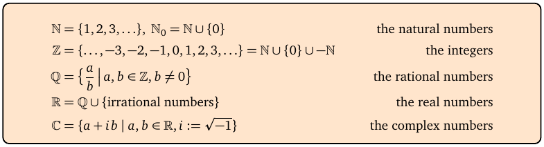
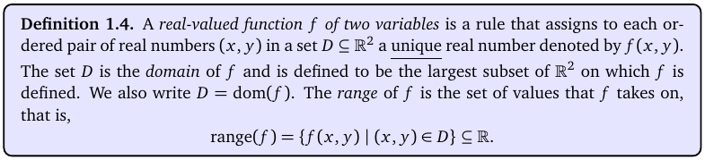
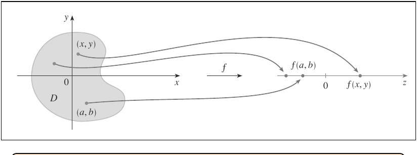
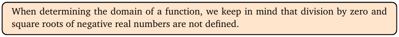
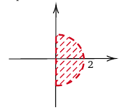
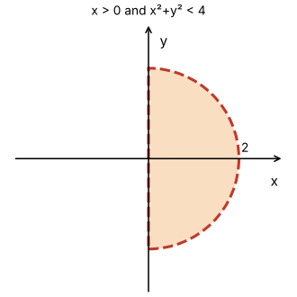
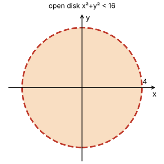
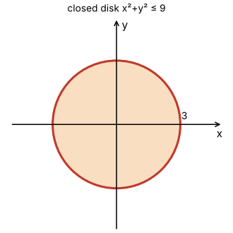

# Topic 1: Sets, functions of several variables, domains

Tutorial questions: Sheet 1 Q1 · Sample exam Q1(a), Q1(b)

Notes pages: 1 to 7 (§1.1 to §1.3) + the `logic_sets` handout + the notation sheet

---

## The big idea

A function of two variables takes a point (x, y) and gives back one number, f(x, y).

The **domain** is every point where the formula makes sense.

You find it by banning three things: dividing by zero, square roots of negatives, and ln of anything ≤ 0.

Then you write the answer in **set notation** and **sketch** it.

That's a guaranteed 2 parts of exam Q1.

---

**How to use these notes:**
When you see 🧠, stop.
Answer it on paper first.
Then click to check.

---

## ⭐ Learn by heart from this topic

There is **no formula sheet** in this exam. So learn these.

The three domain rules:

| Formula has | You need | Example |
|---|---|---|
| a fraction $\frac{A}{B}$ | $B \neq 0$ | $\frac{1}{x-y}$ needs $x \neq y$ |
| a square root $\sqrt{A}$ | $A \geq 0$ | $\sqrt{9-x^2-y^2}$ needs $x^2+y^2 \leq 9$ |
| a log $\ln(A)$ | $A > 0$ | $\ln(x^2+y^2)$ needs $(x,y) \neq (0,0)$ |

 

**Memory hook:**
"No zero downstairs, no negative under a root, nothing ≤ 0 inside ln."

 

The answer template:

$$\text{dom}(f) = \{(x,y) \in \mathbb{R}^2 \mid \text{conditions}\}$$

---

## 1. Sets and set notation

**How to read this box:**

- ℕ = natural numbers 1, 2, 3, … (ℕ₀ adds 0).
- ℤ = all integers, including negatives.
- ℚ = fractions a/b with b ≠ 0.
- ℝ = all real numbers (fractions + irrationals like √2, π).
- ℂ = complex numbers a + ib. You'll only meet these again in Topic 16.

 

**Symbols you must read fluently:**

| Symbol | Say | Means |
|---|---|---|
| ∈ | "is in" | (1, 2) ∈ ℝ² means the point (1,2) is in the plane |
| ℝ² | "R two" | the plane: all points (x, y) |
| ℝ³ | "R three" | space: all points (x, y, z) |
| ∪ | "union" | in A **or** B (or both) |
| ∩ | "intersection" | in A **and** B |
| A \ B | "A minus B" | in A but **not** in B |
| ∅ | "empty set" | nothing |
| \| | "such that" | separates the point from the conditions |

 

**Set-builder notation** reads like a sentence:

$$\{(x,y) \in \mathbb{R}^2 \mid x^2+y^2 < 16\}$$

"All points (x, y) in the plane **such that** x² + y² < 16."

 

**Logic words** (from the `logic_sets` handout):

- "and" (∧) = both must be true. Matches ∩.
- "or" (∨) = at least one true (maths "or" includes both). Matches ∪.
- De Morgan: not (p and q) = (not p) or (not q).

That last one matters for domains: the plane **minus** the points where "x = −1 **or** y = −1" is the set where "x ≠ −1 **and** y ≠ −1".

 

### 🧠 Check
Write in words: $\mathbb{R}^2 \setminus \{(0,0)\}$.

Answer

The whole plane with the origin removed.

It's called the **punctured plane**.

---

## 2. What a function of two variables is

**How to read this box:**

- f takes each point (x, y) in a set D and gives **one** real number f(x, y).
- D is the **domain**. We write D = dom(f).
- The **range** is all the output values f can take.

 

**How to read this diagram:**

- The grey blob D on the left is the domain, a region in the xy-plane.
- Each point (x, y) in the blob gets sent by the arrow f to a number on the line on the right.
- Two different points can land on the same number. That's fine.
- One point can never land on two numbers. That's what "function" means.

 

**Three variables** work the same way: f(x, y, z) takes a point in space ℝ³ and gives one number.

 

### 🧠 Check
f(x, y) = xy + y. Find f(1, 0) and f(1, 1).

Answer

f(1, 0) = 1·0 + 0 = **0**

f(1, 1) = 1·1 + 1 = **2**

---

## 3. Finding the domain

**How to read this box:**

If nobody tells you the domain, it is the **largest** set of points where the formula works.

The only things that can break a formula in this module are ÷ 0, √ of a negative, and ln of something ≤ 0.

---

### 📐 Method: find the domain

| Step | Do this |
|---|---|
| 1 | Look for fractions, square roots, logs. |
| 2 | Write one condition for each (≠ 0, ≥ 0, > 0). |
| 3 | If the **same** expression is under a root **and** downstairs, combine: ≥ 0 and ≠ 0 gives **> 0**. |
| 4 | Simplify each condition into something you can picture (circle, line, axis). |
| 5 | Join the conditions with "and". |
| 6 | Write $\{(x,y) \in \mathbb{R}^2 \mid \ldots\}$ and describe it in words. |

**Use it when:**
Any "determine the domain" question.

**Nothing to ban?** Polynomials, sin, cos and eˣ work everywhere. Then dom(f) = ℝ².

⚠️ **eˣ is never zero**, so $e^{-(x^2+y^2)} = \frac{1}{e^{x^2+y^2}}$ is fine everywhere.

---

### Shapes you must recognise

| Condition | Picture |
|---|---|
| $x^2+y^2 < r^2$ | **open** disk, radius r, centre (0,0). Edge **not** included |
| $x^2+y^2 \leq r^2$ | **closed** disk. Edge included |
| $x^2+y^2 > 0$ | everything except the origin (punctured plane) |
| $y \geq x$ | half-plane on and above the line y = x |
| $x \neq 0$ | plane minus the y-axis (careful: x = 0 **is** the y-axis) |
| $y \neq 0$ | plane minus the x-axis |
| $x^2+2y^2 \neq 0$ | only fails at (0,0), so punctured plane |

⚠️ **Axis trap:** "x = 0" is the **y-axis**, not the x-axis. "y = 0" is the **x-axis**.

 

### 🧠 Check
f(x, y) = sin(x/y). Find the domain.

Answer

Only the fraction can break. Need y ≠ 0.

$$\text{dom}(f) = \{(x,y) \in \mathbb{R}^2 \mid y \neq 0\} = \mathbb{R}^2 \setminus \text{the } x\text{-axis}$$

 

### 🧠 Check
f(x, y) = 1/√(16 − x² − y²). Why is the answer "<" and not "≤"?

Answer

The root needs 16 − x² − y² ≥ 0.

The fraction needs 16 − x² − y² ≠ 0.

Both together: 16 − x² − y² > 0, so x² + y² < 16. An **open** disk.

---

## 4. Sketching the domain

The exam asks "make a sketch of the domain". This is what the official answer looks like:

**How to read this diagram:**

- It's the domain of $f(x,y) = \frac{\ln x}{\sqrt{4-x^2-y^2}}$.
- Shading = the points that are **in** the domain.
- The curve is **dashed**: the circle x² + y² = 4 is **not** included (strict <).
- The y-axis piece is **dashed** too: x = 0 is not included (strict > 0).
- The 2 on the x-axis marks the radius.

 

Same picture, drawn cleanly:

---

### ✏️ Drawing checklist (domain sketch)

1. Draw and label the x and y axes.
2. Draw each boundary curve (circle, line, axis).
3. **Solid** line if the boundary is included (≤, ≥).
4. **Dashed** line if it is not included (<, >, ≠).
5. Shade the region that is in the domain.
6. Mark key numbers: radius, intercepts.
7. A single missing point: draw an **open circle** ○ there.
8. Write the set notation next to it.

 

### 🧠 Check
You need to sketch $\{(x,y) \mid x^2+y^2 \leq 9\}$. Solid or dashed circle?

Answer

**Solid.** The ≤ means the points on the circle x² + y² = 9 are included.

---

## 5. Worked example (Sheet 1 Q1 j, k)

**(j)** $f(x,y) = \frac{1}{\sqrt{16-x^2-y^2}}$

Root and fraction on the same expression, so 16 − x² − y² > 0.

$$\text{dom}(f) = \{(x,y) \in \mathbb{R}^2 \mid x^2+y^2 < 16\}$$

Open disk, centre (0,0), radius 4.

 

**(k)** $f(x,y) = \sqrt{9-x^2-y^2}$

Root only, so 9 − x² − y² ≥ 0.

$$\text{dom}(f) = \{(x,y) \in \mathbb{R}^2 \mid x^2+y^2 \leq 9\}$$

Closed disk, centre (0,0), radius 3.

---

## 6. Graphs of functions (just know the words)

The **graph** of f(x, y) is the surface z = f(x, y) in ℝ³.

The domain is the "shadow" of that surface on the xy-plane.

Example: $z = \sqrt{1-x^2-y^2}$ is the top half of a sphere of radius 1. Its domain is the closed unit disk.

You won't be asked to draw 3D surfaces. Topic 2 shows how to picture them with level curves.

---

## Method table

| You're asked for | Use |
|---|---|
| the domain, in set notation | the three bans (§3) → $\{(x,y) \in \mathbb{R}^2 \mid \ldots\}$ |
| a geometric description | the shapes table (§3): disk, half-plane, punctured plane… |
| a sketch | the drawing checklist (§4) |
| f at a point | substitute the numbers (§2) |

---

Next: [End-of-topic test](../questions/01-sets-domains.md)
