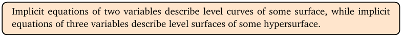
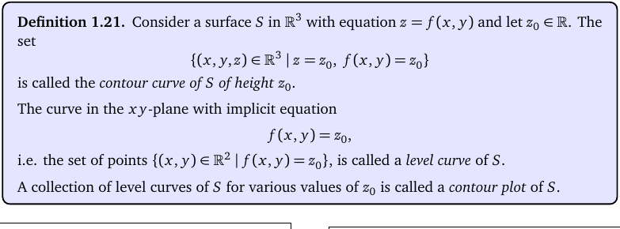
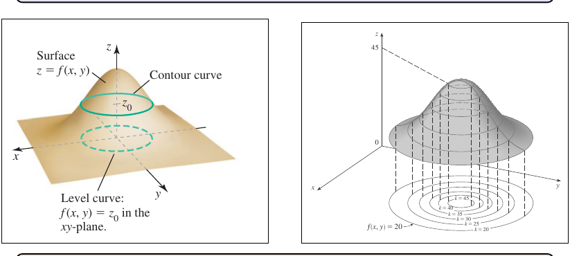
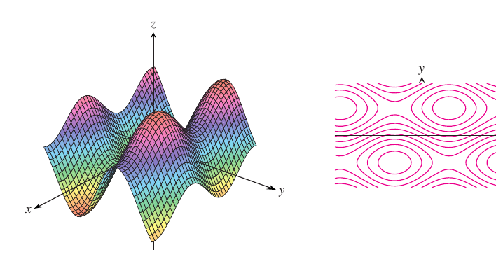
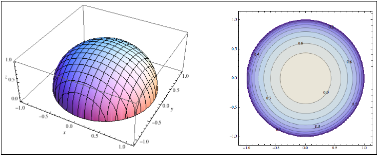
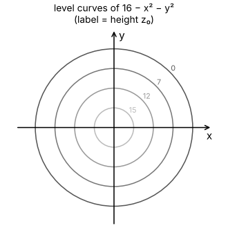
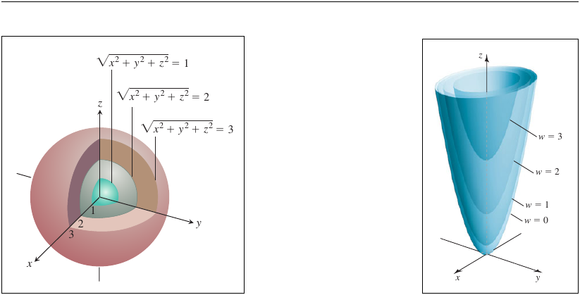
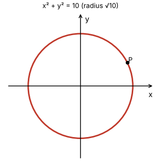

# Topic 2: Level curves and level surfaces

Tutorial questions: Sheet 1 Q2

Notes pages: 8 to 13 (§1.4, §1.5)

---

## The big idea

A surface z = f(x, y) is hard to draw.

So slice it with flat planes z = z₀ (horizontal cuts at height z₀).

Each slice, flattened onto the xy-plane, is a **level curve** f(x, y) = z₀.

Lots of level curves together make a **contour plot**, like the height lines on a hiking map.

For f(x, y, z) you get **level surfaces** f(x, y, z) = w₀ instead.

---

**How to use these notes:**
When you see 🧠, stop.
Answer it on paper first.
Then click to check.

---

## ⭐ Learn by heart from this topic

Level curve of f through the point P = (a, b):

$$f(x,y) = f(a,b)$$

That's it. Work out the number f(a, b), then set f(x, y) equal to it.

 

**Memory hook:**
"Level curve = same height." Every point on it has the same f value as P.

---

## 1. Explicit vs implicit equations

**How to read this box:**

Implicit equations in 2 variables (like x² + y² = 1) are curves. Each one is a level curve of some surface.

Implicit equations in 3 variables (like x² + y² + z² = 1) are surfaces. Each one is a level surface.

 

| Type | Looks like | Example |
|---|---|---|
| **explicit** | one variable alone on one side | y = x², z = 4 − x² − y² |
| **implicit** | everything mixed, = constant | x² + y² = 1, xyz + eˣ = 3 |

You can always turn explicit into implicit (move everything to one side).

You **can't** always go back. x² + y² = 1 gives y = +√(1−x²) **or** y = −√(1−x²): two pieces, not one function.

 

### 🧠 Check
Is z = x² + y² explicit or implicit? Rewrite it the other way.

Answer

Explicit (z is alone).

Implicit form: x² + y² − z = 0.

---

## 2. Level curves

**How to read this box:**

- Cut the surface z = f(x, y) with the flat plane z = z₀.
- The cut is a curve in space called a **contour curve**.
- Drop it straight down onto the xy-plane: that's the **level curve** f(x, y) = z₀.
- z₀ is a fixed number. x and y vary.

 

**How to read this diagram:**

- Left: the hill is the surface z = f(x, y).
- The green ring on the hill is where the plane at height z₀ slices it (contour curve).
- The dashed green ring on the floor is its shadow: the level curve f(x, y) = z₀.
- Right: many slices at different heights, all dropped onto the floor. That stack of rings is the **contour plot**.
- Rings close together = steep. Rings far apart = gentle.

 

### 🧠 Check
On a contour plot, the level curves are bunched tightly on the left and spread out on the right. Where is the surface steeper?

Answer

On the **left**. The height changes a lot over a short distance there.

---

## 3. Two worked pictures

**How to read this diagram:**

- Left: the egg-box surface z = sin x + 2 sin y.
- Right: its level curves. The little closed loops sit under the bumps and dips.
- You can see the hills and valleys from the flat picture alone.

 

**How to read this diagram:**

- Left: the half-sphere $z = \sqrt{1-x^2-y^2}$.
- Right: its level curves are **circles** centred at the origin.
- Why? Set $\sqrt{1-x^2-y^2} = z_0$. Square: x² + y² = 1 − z₀². A circle of radius $\sqrt{1-z_0^2}$.

 

My own example: the level curves of f(x, y) = 16 − x² − y² are circles too.

- Height 15 → radius 1. Height 12 → radius 2. Height 7 → radius 3.
- Bigger circle = lower height. It's an upside-down bowl.

---

### 📐 Method: level curve through a point P

| Step | Do this |
|---|---|
| 1 | Plug P = (a, b) into f. Call the answer z₀. |
| 2 | Write f(x, y) = z₀. |
| 3 | Simplify until you recognise it (circle, line, pair of lines…). |
| 4 | Say what it is in words. |

**Use it when:**
"Find an equation for the level curve that passes through P."

⚠️ A level curve can be in **several pieces**. x² = 1 is **two** lines, x = 1 and x = −1.

 

### 🧠 Check
f(x, y) = x² + y². Find the level curve through (3, 4).

Answer

z₀ = f(3, 4) = 9 + 16 = 25.

Level curve: x² + y² = 25. A circle, centre (0,0), radius 5.

---

## 4. Level curves when f needs first-year tricks (Sheet 1 Q2 c, d)

Two tutorial parts hide a first-year fact. Spot it first, then use the method.

**An integral:**

$$\int_x^y \frac{dt}{1+t^2} = \tan^{-1}(y) - \tan^{-1}(x)$$

**A geometric series:**

$$\sum_{n=0}^{\infty} r^n = \frac{1}{1-r} \quad \text{when } |r| < 1$$

 

### 🧠 Check
Simplify $\sum_{n=0}^{\infty} \left(\frac{x}{y}\right)^n$ when |x/y| < 1.

Answer

$$\frac{1}{1-\frac{x}{y}} = \frac{y}{y-x}$$

(Multiply top and bottom by y.)

---

## 5. Level surfaces (three variables)

For w = f(x, y, z) you'd need 4 dimensions to draw the graph. Impossible.

So instead draw the **level surfaces** f(x, y, z) = w₀. Each one is a surface in ℝ³.

**How to read this diagram:**

- Left: $f(x,y,z) = \sqrt{x^2+y^2+z^2}$. Its level surfaces are **spheres** of radius 1, 2, 3 nested like an onion.
- Right: $f(x,y,z) = \sqrt{z-x^2-2y^2}$. Its level surfaces are **elliptic paraboloids** (bowls) stacked inside each other.

 

### 🧠 Check
Describe the level surface x² + y² + z² = 9.

Answer

A sphere, centre the origin, radius 3.

---

## 6. Worked example (Sheet 1 Q2 a)

f(x, y) = 16 − x² − y², P = (2√2, √2).

**Step 1:** f(2√2, √2) = 16 − 8 − 2 = 6.

**Step 2:** 16 − x² − y² = 6.

**Step 3:** x² + y² = 10.

**Step 4:** A circle, centre the origin, radius √10.

---

## Method table

| You're asked for | Use |
|---|---|
| the level curve through P | f(x, y) = f(P), then simplify (§3) |
| what the level curves look like | set f = z₀ for a general z₀ and recognise the shape (§3) |
| which way is steep on a contour plot | close curves = steep (§2) |
| a level surface | f(x, y, z) = w₀ (§5) |

---

Next: [End-of-topic test](../questions/02-level-curves.md)
