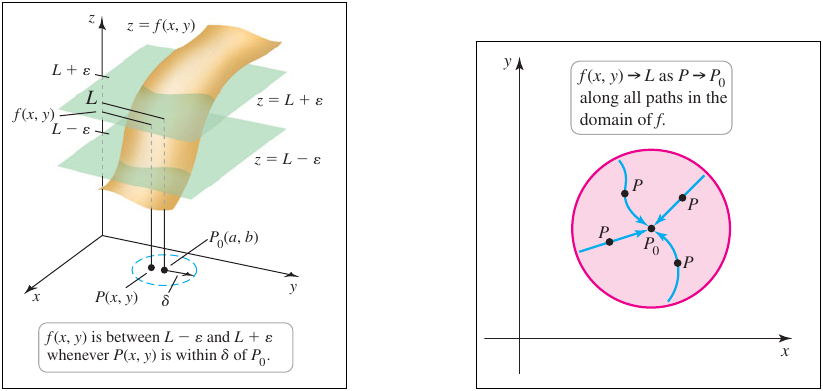
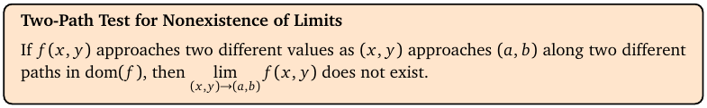
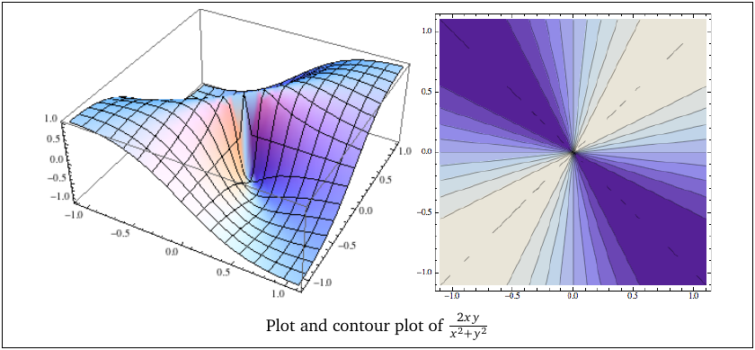
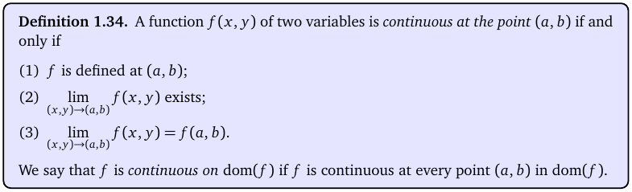
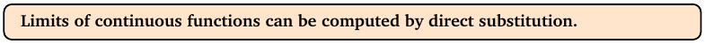

# Topic 3: Limits and continuity

Tutorial questions: Sheet 1 Q3, Q4, Q5, Q6, Q7 · Sample exam Q1(c)

Notes pages: 13 to 18 (§1.6)

---

## The big idea

A limit asks: what value does f(x, y) get close to as (x, y) gets close to a point (a, b)?

In one variable you can only come from the left or right.

In two variables you can come from **any direction**, along any path.

So:
- To show a limit **doesn't exist**: find two paths that give different answers.
- To **find** a limit: if f is continuous there, just substitute. If you get 0/0, simplify first.

---

**How to use these notes:**
When you see 🧠, stop.
Answer it on paper first.
Then click to check.

---

## ⭐ Learn by heart from this topic

1. **Two-path test:** two paths, two different values → no limit.
2. **Continuous at (a, b)** means all three: f(a, b) is defined, the limit exists, and they're equal.
3. **Polynomials** are continuous everywhere. **Rational functions** (polynomial ÷ polynomial) are continuous wherever the bottom ≠ 0. Same for sin, cos, eˣ, and ln/√ on their domains.
4. **Continuous → substitute.**
5. **0/0 → factor and cancel** (or multiply by the conjugate), then substitute.

---

## 1. What a limit means

**How to read this diagram:**

- Left: the surface z = f(x, y), and two flat green planes at heights L + ε and L − ε.
- Near P₀ = (a, b) the surface stays squeezed between the two planes.
- The small dashed circle on the floor is a disk of radius δ around P₀.
- In words: if (x, y) is close enough to (a, b), then f(x, y) is close to L.
- Right: P₀ is the centre of the pink disk. The points P come in from **every** direction, along curvy paths too. They must all lead to the same L.

You don't need the ε-δ definition for the exam. You need the idea: **every** path must give the same answer.

 

### 🧠 Check
In one variable, how many directions can x approach a from? In two variables?

Answer

One variable: two (left and right).

Two variables: infinitely many, along any line or curve.

---

## 2. Showing a limit does NOT exist

**How to read this box:**

If f heads to one value along one path and a different value along another path, the limit doesn't exist.

---

### 📐 Method: two-path test (limit at (0, 0))

| Step | Do this |
|---|---|
| 1 | Pick path 1. Try the x-axis first: put y = 0. |
| 2 | Simplify f(x, 0) and let x → 0. Call it L₁. |
| 3 | Pick path 2. Try the y-axis: put x = 0. Get L₂. |
| 4 | If L₁ = L₂, try a line y = mx (y = x, y = 2x, y = −x …) instead. |
| 5 | Once L₁ ≠ L₂, write: "f → L₁ along path 1 and f → L₂ along path 2, so the limit does not exist." |

**Use it when:**
"Show that the limit does not exist."

**Do NOT use it when:**
You want to **find** a limit. Getting the same value on two paths proves nothing. There could be a third path that disagrees.

 

**Example (notes Ex 1.33):** $\lim \frac{x^2-y^2}{x^2+y^2}$ at (0,0).

- Along the x-axis (y = 0): $\frac{x^2}{x^2} = 1 \to 1$.
- Along the y-axis (x = 0): $\frac{-y^2}{y^2} = -1 \to -1$.
- 1 ≠ −1, so no limit.

 

**How to read this diagram:**

- It's $f(x,y) = \frac{2xy}{x^2+y^2}$.
- Left: the surface is "pinched" at the origin. It's a twisted sheet.
- Right: the contour plot. Every straight line through (0, 0) is a level curve with its own height.
- On y = x the value is always 1. On y = −x it's always −1. So no limit at (0,0).

 

### 🧠 Check
For $\frac{2xy}{x^2+y^2}$, what do you get along the line y = x?

Answer

$$\frac{2x \cdot x}{x^2+x^2} = \frac{2x^2}{2x^2} = 1$$

So f → 1 along y = x.

 

⚠️ **Absolute values and roots:** $\sqrt{x^2} = |x|$, not x. To get rid of |x|, approach along the **positive** x-axis (x > 0), so |x| = x.

---

## 3. Continuity

**How to read this box:**

f is continuous at (a, b) if all three hold:
1. f(a, b) is defined.
2. The limit at (a, b) exists.
3. The limit equals f(a, b).

Continuous on dom(f) means continuous at every point of the domain.

Picture: no holes, jumps or tears in the surface.

 

**Which functions are continuous?**

| Function | Continuous where |
|---|---|
| polynomials, e.g. x²y + 3y | everywhere, ℝ² |
| rational: polynomial ÷ polynomial | wherever the bottom ≠ 0 |
| sin, cos, eˣ of something continuous | wherever the inside is |
| ln(A), √A | wherever A is continuous **and** A > 0 (ln) or A ≥ 0 (√) |
| sums, products, quotients, compositions | wherever each piece is (and no ÷ 0) |

So "where is f continuous?" usually has the **same answer as the domain** (Topic 1).

 

### 🧠 Check
Where is $f(x,y) = \frac{x+y}{x-y}$ continuous?

Answer

A rational function, so wherever x − y ≠ 0:

$$\{(x,y) \in \mathbb{R}^2 \mid x \neq y\}$$

The plane without the line y = x.

---

## 4. Finding limits

**How to read this box:**

If f is continuous at the point, the limit is just f(point). Plug the numbers in.

---

### 📐 Method: find a limit

| Step | Do this |
|---|---|
| 1 | Try substituting. If you get a real number (not 0/0), that's the answer. Say "f is continuous at (a, b)". |
| 2 | If you get 0/0, **factor** top and bottom. Look for a common factor like (x − y) or (x − 1). |
| 3 | Cancel it. That's allowed because points approaching (a, b) are in the domain, so the factor isn't 0 on them. |
| 4 | With square roots, use the **conjugate** or the difference of squares: $x - y = (\sqrt{x}-\sqrt{y})(\sqrt{x}+\sqrt{y})$. |
| 5 | Substitute into the simplified version. |

**Use it when:**
"Find the limit."

 

**Factoring tricks you'll need:**

| Spot | Factor |
|---|---|
| $x^2-2xy+y^2$ | $(x-y)^2$ |
| $xy - y - 2x + 2$ | group: $y(x-1) - 2(x-1) = (y-2)(x-1)$ |
| $x - y$ with roots | $(\sqrt{x}-\sqrt{y})(\sqrt{x}+\sqrt{y})$ |
| $x^3-2x^2 - xy^2 + 2y^2$ | group: $x^2(x-2) - y^2(x-2) = (x-2)(x^2-y^2)$ |

 

### 🧠 Check
$$\lim_{(x,y)\to(1,1)} \frac{x^2-2xy+y^2}{x-y}$$

Answer

Substituting gives 0/0.

$$\frac{(x-y)^2}{x-y} = x - y$$

Now substitute: 1 − 1 = **0**.

---

## 5. Continuous extension

Sometimes f is undefined at one point, but the limit there exists.

Then you can **fill the hole**: define a new function g that equals f everywhere else, and equals the limit at that point.

g is called the **continuous extension** of f.

 

**Notes Example 1.40:** $f(x,y) = \frac{x^2+y^2-x^3-xy^2}{x^2+y^2}$ isn't defined at (0,0).

Top = (1 − x)(x² + y²), so f = 1 − x away from (0,0). The limit is 1.

So g(x, y) = f(x, y) for (x, y) ≠ (0, 0), and g(0, 0) = 1.

---

### 📐 Method: continuous extension at (a, b)

| Step | Do this |
|---|---|
| 1 | Check f(a, b) is 0/0 (undefined). |
| 2 | Factor and cancel to find the limit L. |
| 3 | Write: g(x, y) := f(x, y) when (x, y) ≠ (a, b), and g(a, b) := L. |

 

### 🧠 Check
Why is g continuous at (a, b)?

Answer

All three conditions hold: g(a, b) = L is defined, the limit exists and is L, and they're equal.

---

## 6. Worked example (Sample exam Q1 c)

$$\lim_{(x,y)\to(1,0)} \frac{\ln(x)}{\sqrt{4-x^2-y^2}}$$

(1, 0) is in the domain (x = 1 > 0, and 1 + 0 < 4). f is continuous on its domain. So substitute:

$$\frac{\ln 1}{\sqrt{4-1}} = \frac{0}{\sqrt{3}} = 0$$

Official answer: 0.

---

## Method table

| You're asked for | Use |
|---|---|
| show the limit does not exist | two-path test (§2) |
| where f is continuous | the continuity table: usually the same as the domain (§3) |
| a limit, and substituting works | direct substitution (§4) |
| a limit, and substituting gives 0/0 | factor, cancel, substitute (§4) |
| the continuous extension | find the limit, then define g (§5) |

---

Next: [End-of-topic test](../questions/03-limits-continuity.md)
