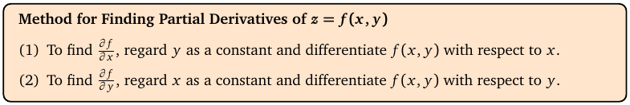
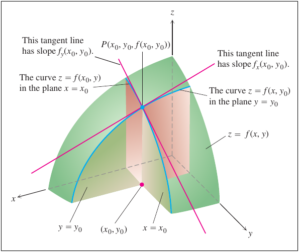

# Topic 4: Partial derivatives

Tutorial questions: Sheet 2 Q1, Q2 · Sample exam Q2(a)

Notes pages: 19 to 22 (§2.1 to §2.5)

---

## The big idea

f(x, y) depends on two things.

A **partial derivative** asks how f changes when you move **one** of them and freeze the other.

- $f_x$: wiggle x, keep y fixed.
- $f_y$: wiggle y, keep x fixed.

So you already know how to do it: it's normal differentiation, with the other letter treated like a number.

Every later topic uses this. Get fast at it.

---

**How to use these notes:**
When you see 🧠, stop.
Answer it on paper first.
Then click to check.

---

## ⭐ Learn by heart from this topic

$$f_x = \frac{\partial f}{\partial x}: \text{ differentiate in } x, \text{ treat } y \text{ (and } z\text{) as constants}$$

$$f_y = \frac{\partial f}{\partial y}: \text{ differentiate in } y, \text{ treat } x \text{ (and } z\text{) as constants}$$

Plus your first-year rules: product, quotient, chain.

| Rule | Formula |
|---|---|
| product | $(uv)' = u'v + uv'$ |
| quotient | $\left(\frac{u}{v}\right)' = \frac{u'v - uv'}{v^2}$ |
| chain | $\left(g(u)\right)' = g'(u)\cdot u'$ |

**Memory hook:**
"Freeze the others." The letter you're not differentiating is just a number like 7.

---

## 1. The definition

**How to read this box:**

- To find ∂f/∂x: pretend y is a constant, and differentiate with respect to x.
- To find ∂f/∂y: pretend x is a constant, and differentiate with respect to y.

 

The formal definition (notes Def 2.1) is the first-year limit, moving in one direction only:

$$f_x(x,y) = \lim_{h\to0} \frac{f(x+h,y) - f(x,y)}{h}$$

You won't need the limit. You'll always use the rules.

 

**Notation.** All of these mean the same:

$$f_x = \frac{\partial f}{\partial x} = \frac{\partial z}{\partial x} = z_x = D_x f$$

The curly ∂ ("partial", or "del") warns you there's more than one variable.

**At a point:** $f_x(1, 0)$ means "work out $f_x$, **then** put x = 1, y = 0 in".

 

### 🧠 Check
f(x, y) = x² + y² + 2xeʸ. Find $f_x$ and $f_y$, then $f_x(1, 0)$.

Answer

$f_x = 2x + 2e^y$ (y is frozen, so eʸ is a constant).

$f_y = 2y + 2xe^y$.

$f_x(1, 0) = 2 + 2 = 4$.

(Notes Example 2.6.)

---

## 2. What a partial derivative means on the surface

**How to read this diagram:**

- The green surface is z = f(x, y). P is a point on it, above (x₀, y₀).
- The plane y = y₀ (fixed y) slices the surface along a blue curve. Its tangent line at P (pink) has slope $f_x(x_0, y_0)$.
- The plane x = x₀ (fixed x) slices along the other blue curve. Its tangent line has slope $f_y(x_0, y_0)$.
- So $f_x$ is the slope walking in the x-direction. $f_y$ is the slope walking in the y-direction.

 

### 🧠 Check
$f_x(2, 3) = -5$. You stand on the surface above (2, 3) and step in the +x direction. Up or down?

Answer

Down. Negative slope means f decreases as x increases.

---

## 3. Doing it fast

### 📐 Method: first-order partial derivatives

| Step | Do this |
|---|---|
| 1 | Pick the variable. Circle it. Every other letter is now a constant. |
| 2 | Terms with no circled letter: derivative is **0**. |
| 3 | Constant × something: keep the constant in front. E.g. ∂/∂x (x cos 3y) = cos 3y. |
| 4 | Inside a function (sin, e, ln, √): use the **chain rule**. Multiply by the partial of the inside. |
| 5 | Fractions with the variable top and bottom: quotient rule. |
| 6 | Tidy up. Factor if it helps. |

**Use it when:**
Always. Every topic from here on.

 

**Chain-rule patterns you'll use all the time:**

| f | $f_x$ |
|---|---|
| $e^{u}$ | $e^{u}\cdot u_x$ |
| $\sin u$ | $\cos u \cdot u_x$ |
| $\cos u$ | $-\sin u \cdot u_x$ |
| $\ln u$ | $\frac{u_x}{u}$ |
| $\sqrt{u} = u^{1/2}$ | $\frac{u_x}{2\sqrt{u}}$ |
| $u^n$ | $n u^{n-1} u_x$ |

 

### 🧠 Check
Find $f_x$ and $f_y$ for f(x, y) = sin(xy).

Answer

Inside u = xy. $u_x = y$, $u_y = x$.

$f_x = y\cos(xy)$

$f_y = x\cos(xy)$

 

### 🧠 Check
Find $f_x$ for $f = e^{2x-3y}$.

Answer

$f_x = 2e^{2x-3y}$

(The inside 2x − 3y has x-partial 2.)

---

## 4. Three or more variables

Same rule: freeze **all** the others.

f(x, y, z) has three first partials, $f_x$, $f_y$, $f_z$.

f(x₁, …, xₙ) has n of them.

 

**Example (notes Ex 2.10):** g = x²y³ + y⁴z⁵ + z⁶x⁷

$g_x = 2xy^3 + 7z^6x^6$

$g_y = 3x^2y^2 + 4y^3z^5$

$g_z = 5y^4z^4 + 6z^5x^7$

 

### 🧠 Check
f = (x + 1)(y + 2)²(z + 3)³. Find $f_y$.

Answer

(x + 1) and (z + 3)³ are constants. Differentiate (y + 2)²:

$f_y = 2(x+1)(y+2)(z+3)^3$

---

## 5. Worked example (Sample exam Q2 a)

$$f(x,y) = \sqrt{\sin(x^2y^3)}$$

Write it as $(\sin(x^2y^3))^{1/2}$. Three layers: power, sin, then x²y³. Chain rule through all three.

**f_x:**

$$f_x = \frac12 \left(\sin(x^2y^3)\right)^{-1/2} \cdot \cos(x^2y^3) \cdot 2xy^3 = \frac{xy^3\cos(x^2y^3)}{\sqrt{\sin(x^2y^3)}}$$

**f_y:**

$$f_y = \frac12 \left(\sin(x^2y^3)\right)^{-1/2} \cdot \cos(x^2y^3) \cdot 3x^2y^2 = \frac{3x^2y^2\cos(x^2y^3)}{2\sqrt{\sin(x^2y^3)}}$$

Matches the official answer.

---

## Method table

| You're asked for | Use |
|---|---|
| $f_x$, $f_y$ (or $f_z$) | freeze the other letters, differentiate (§3) |
| a partial at a point | differentiate first, then substitute (§1) |
| what $f_x$ means | slope of the surface in the x-direction (§2) |

---

Next: [End-of-topic test](../questions/04-partial-derivatives.md)
