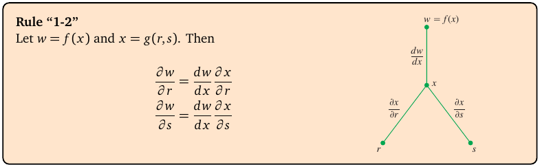
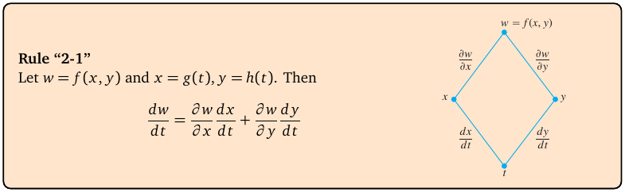
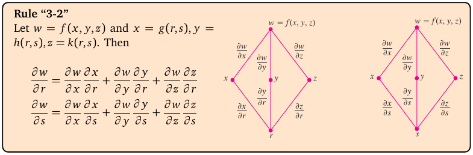

# Topic 5: Chain rules and tree diagrams

Tutorial questions: Sheet 2 Q3, Q4, Q5, Q6 · Sample exam Q2(b), Q2(c)

Notes pages: 23 to 25 (§2.6)

---

## The big idea

w depends on x and y. But x and y themselves depend on something else (t, or r and s).

So w depends on t **through** x and y.

The chain rule adds up every route from w down to t:

$$\frac{dw}{dt} = (\text{w via x}) + (\text{w via y})$$

Each route = multiply the derivatives along it.

A **tree diagram** shows the routes so you can't miss one.

---

**How to use these notes:**
When you see 🧠, stop.
Answer it on paper first.
Then click to check.

---

## ⭐ Learn by heart from this topic

**One parameter** (w = f(x, y, z), each of x, y, z depends on t):

$$\frac{dw}{dt} = \frac{\partial w}{\partial x}\frac{dx}{dt} + \frac{\partial w}{\partial y}\frac{dy}{dt} + \frac{\partial w}{\partial z}\frac{dz}{dt}$$

Short form: $w'(t) = w_x x_t + w_y y_t + w_z z_t$.

 

**Two parameters** (w = f(x, y), x and y depend on r and s):

$$w_r = w_x x_r + w_y y_r$$

$$w_s = w_x x_s + w_y y_s$$

 

**Memory hook:**
"One term per middle variable. Each term = (w by that variable) × (that variable by the bottom one)."

---

## 1. The three rules

**How to read this box:**

- Rule "1-2": w depends on **one** middle variable x, and x depends on **two** variables r, s.
- The tree: w at the top, x in the middle, r and s at the bottom.
- Only one route from w to r, so $\frac{\partial w}{\partial r} = \frac{dw}{dx}\frac{\partial x}{\partial r}$.
- It's straight d for dw/dx because w depends on x only.

 

**How to read this box:**

- Rule "2-1": w depends on **two** middle variables x, y. Both depend on **one** variable t.
- The tree is a diamond: w → x → t and w → y → t.
- Two routes, so two terms: $\frac{dw}{dt} = \frac{\partial w}{\partial x}\frac{dx}{dt} + \frac{\partial w}{\partial y}\frac{dy}{dt}$.
- dw/dt is a straight d because, in the end, w depends on t alone.

 

**How to read this box:**

- Rule "3-2": w depends on **three** middle variables x, y, z. Each depends on **two** variables r, s.
- Left tree: the three routes from w down to r. Right tree: the three routes down to s.
- So each of $w_r$ and $w_s$ has three terms.

 

There's a pattern: **number of terms = number of middle variables**. You can build any chain rule from a tree.

 

### 🧠 Check
w = f(x, y), x = g(r, s), y = h(r, s). How many terms are in $w_s$? Write it.

Answer

Two middle variables, so two terms:

$$w_s = w_x x_s + w_y y_s$$

---

### 📐 Method: chain rule

| Step | Do this |
|---|---|
| 1 | Draw the tree: w on top, middle variables, bottom variables. |
| 2 | Write one term for each route from w to the bottom variable you want. |
| 3 | Work out every piece: $w_x, w_y, \ldots$ and $x_t, y_t, \ldots$ (or $x_r, y_r, \ldots$). |
| 4 | Multiply along each route and add. |
| 5 | If asked "at t = 1": find x, y, z at t = 1 first, then substitute everything. |

**Use it when:**
"Use the chain rule to find w′(t)" or "express $w_r$ and $w_s$ in terms of $w_x$, $w_y$".

**Do NOT just substitute** when the question says "use the chain rule". You lose the method marks.

---

## 2. One parameter: w′(t)

**Example (Sheet 2 Q3):** w = xy²e²ᶻ, x = 3t² + 1, y = 6t, z = t³ − 1.

The pieces:

| | |
|---|---|
| $w_x = y^2e^{2z}$ | $x_t = 6t$ |
| $w_y = 2xye^{2z}$ | $y_t = 6$ |
| $w_z = 2xy^2e^{2z}$ | $z_t = 3t^2$ |

$$w'(t) = y^2e^{2z}(6t) + 2xye^{2z}(6) + 2xy^2e^{2z}(3t^2)$$

Now put x, y, z back in terms of t (y² = 36t², etc.):

$$w'(t) = 216t^3e^{2(t^3-1)} + 72t(3t^2+1)e^{2(t^3-1)} + 216t^4(3t^2+1)e^{2(t^3-1)}$$

 

### 🧠 Check
In the first term, why is it 216t³?

Answer

y²·6t = 36t²·6t = 216t³.

---

## 3. Two parameters: $w_r$ and $w_s$

Here w is a **general** function, so you can't compute $w_x$ and $w_y$. You leave them as letters.

**Example (notes Ex 2.15):** x = r² − s², y = 2rs.

$x_r = 2r$, $x_s = -2s$, $y_r = 2s$, $y_s = 2r$.

$$w_r = 2r\,w_x + 2s\,w_y$$

$$w_s = -2s\,w_x + 2r\,w_y$$

 

**"Hence show that…" questions** (Sheet 2 Q4–Q6) then ask you to square and add (or subtract) these two lines.

The trick: the **cross terms** $w_xw_y$ cancel.

$$w_r^2 = 4r^2w_x^2 + 8rs\,w_xw_y + 4s^2w_y^2$$

$$w_s^2 = 4s^2w_x^2 - 8rs\,w_xw_y + 4r^2w_y^2$$

$$w_r^2 + w_s^2 = 4(r^2+s^2)(w_x^2+w_y^2)$$

 

### 🧠 Check
Why did the $w_xw_y$ terms cancel?

Answer

They were +8rs in one line and −8rs in the other. Adding gives 0.

---

## 4. Solving for $w_x$ when you know $w_r$ and $w_s$

Sample exam Q2(c) turns it round: it gives you **numbers** for $w_r$ and $w_s$, and asks for $w_x$.

The two chain-rule lines become **two simultaneous equations** in the two unknowns $w_x$, $w_y$. Solve them.

---

## 5. Worked example (Sample exam Q2 b)

w = sin(xyz), x = 1 + t², y = 1 − 2t, z = t³ − 2. Find w′(1).

**Pieces:** $w_x = \cos(xyz)\,yz$, $w_y = \cos(xyz)\,xz$, $w_z = \cos(xyz)\,xy$.

$x_t = 2t$, $y_t = -2$, $z_t = 3t^2$.

**At t = 1:** x = 2, y = −1, z = −1, so xyz = 2.

$$w'(1) = \cos 2\,(1)(2) + \cos 2\,(-2)(-2) + \cos 2\,(-2)(3)$$

$$= 2\cos 2 + 4\cos 2 - 6\cos 2 = 0$$

Official answer: 0.

---

## 6. Worked example (Sample exam Q2 c)

x = r² + s², y = cos(rs). At r = 2, s = π/4 you know $w_r = 8$, $w_s = \pi$. Find $w_x$.

**Chain rule:**

$x_r = 2r$, $y_r = -s\sin(rs)$, $x_s = 2s$, $y_s = -r\sin(rs)$.

At r = 2, s = π/4: rs = π/2, sin(π/2) = 1.

$$8 = 4w_x - \frac{\pi}{4}w_y \qquad (1)$$

$$\pi = \frac{\pi}{2}w_x - 2w_y \qquad (2)$$

**Eliminate $w_y$:** (1) × 8: 64 = 32w_x − 2πw_y. (2) × π: π² = (π²/2)w_x − 2πw_y.

Subtract: $64 - \pi^2 = \left(32 - \frac{\pi^2}{2}\right)w_x = \frac12(64 - \pi^2)w_x$.

$$w_x = 2$$

Official answer: 2.

---

## Method table

| You're asked for | Use |
|---|---|
| w′(t), w depends on t through x, y, z | $w_xx_t + w_yy_t + w_zz_t$ (§2) |
| $w_r$, $w_s$ in terms of $w_x$, $w_y$ | $w_r = w_xx_r + w_yy_r$, same for s (§3) |
| "hence show $w_r^2 + w_s^2 = \ldots$" | square both lines, add, cross terms cancel (§3) |
| $w_x$ given numbers for $w_r$, $w_s$ | two simultaneous equations (§4, §6) |
| the value at t = 1 | find x, y, z at t = 1 first (§5) |

---

Next: [End-of-topic test](../questions/05-chain-rule.md)
