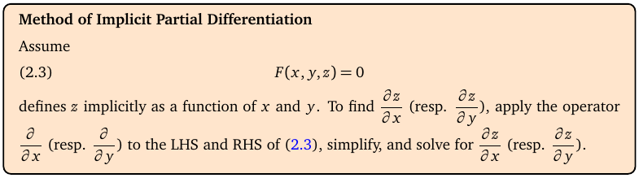
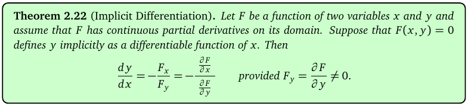

# Topic 6: Implicit partial differentiation

Tutorial questions: Sheet 2 Q7, Q8 · Sample exam Q3(a)

Notes pages: 25 to 28 (§2.7)

---

## The big idea

Sometimes z is tied to x and y by an equation you can't solve for z.

Example: xyz + e^(x+y+z) = 3.

You can still find $z_x$ and $z_y$.

Differentiate **both sides** of the equation, remembering that z secretly depends on x and y. Then solve for $z_x$.

---

**How to use these notes:**
When you see 🧠, stop.
Answer it on paper first.
Then click to check.

---

## ⭐ Learn by heart from this topic

If F(x, y, z) = c defines z as a function of x and y:

$$z_x = -\frac{F_x}{F_z} \qquad z_y = -\frac{F_y}{F_z} \qquad (F_z \neq 0)$$

And for a curve F(x, y) = c (notes Theorem 2.22):

$$\frac{dy}{dx} = -\frac{F_x}{F_y}$$

**Memory hook:**
"Minus, top letter over bottom letter." For $z_x$: minus F_x over F_z.

**Don't forget the minus.** It's the most common mistake.

---

## 1. The method in the notes

**How to read this box:**

- F(x, y, z) = 0 defines z as a function of x and y.
- To get $z_x$: apply ∂/∂x to **both** sides, simplify, solve for $z_x$.
- To get $z_y$: same with ∂/∂y.

---

### 📐 Method A: differentiate both sides (the notes' way)

| Step | Do this |
|---|---|
| 1 | Apply ∂/∂x to every term on both sides. y is constant. z is **not**: it's z(x, y). |
| 2 | Every time you differentiate something with z in it, the chain rule gives an extra factor $z_x$. E.g. ∂/∂x(z²) = 2z·z_x. |
| 3 | Products with z need the product rule: ∂/∂x(xz) = z + x·z_x. |
| 4 | The right side is a constant, so its derivative is 0. |
| 5 | Collect the $z_x$ terms on one side, factor, divide. |
| 6 | Substitute the point (x, y, z). |
| 7 | Repeat with ∂/∂y for $z_y$. |

 

### 📐 Method B: the formula (quicker check)

Move everything to one side: F(x, y, z) = 0.

$$z_x = -\frac{F_x}{F_z}, \qquad z_y = -\frac{F_y}{F_z}$$

Here $F_x$, $F_y$, $F_z$ are ordinary partials of F, treating x, y, z all as independent.

**Use it when:**
You want speed, or to check Method A.

 

### 🧠 Check
x³ + y³ + z³ + 6xyz = 1. Find $z_x$ (notes Ex 2.19).

Answer

Method A: 3x² + 3z²z_x + 6yz + 6xy·z_x = 0.

$z_x(3z^2 + 6xy) = -3x^2 - 6yz$

$$z_x = -\frac{x^2 + 2yz}{z^2 + 2xy}$$

Method B: F_x = 3x² + 6yz, F_z = 3z² + 6xy. Same answer.

---

## 2. Why the formula works (2 lines)

Differentiate F(x, y, z(x, y)) = c with respect to x using the chain rule (Topic 5):

$$F_x \cdot 1 + F_y \cdot 0 + F_z \cdot z_x = 0$$

(x changes at rate 1, y doesn't change, z changes at rate $z_x$.) Solve: $z_x = -F_x/F_z$.

 

**How to read this box:**

The same idea for a curve F(x, y) = 0: dy/dx = −F_x / F_y, as long as F_y ≠ 0.

You'll use this one in Topic 9 for tangent lines.

---

## 3. Using symmetry

If swapping x and y leaves the equation unchanged, then you get $z_y$ from $z_x$ by swapping x and y in the answer.

x³ + y³ + z³ + 6xyz = 1 is symmetric, so

$$z_y = -\frac{y^2 + 2xz}{z^2 + 2xy}$$

 

### 🧠 Check
Is xyz + e^(x+y+z) = 3 symmetric in x and y?

Answer

Yes. Swapping x and y gives yxz + e^(y+x+z) = 3, the same equation.

---

## 4. Where are $z_x$ and $z_y$ both zero?

Sheet 2 Q7 and Q8 ask for the points where $z_x = z_y = 0$.

| Step | Do this |
|---|---|
| 1 | Set the **top** of $z_x$ to 0 and the top of $z_y$ to 0. |
| 2 | Solve those two equations to link x, y, z (e.g. y = 0, z = 2x). |
| 3 | Substitute into the **original** equation to pin down the numbers. |
| 4 | Check the bottom ($F_z$) isn't 0 there. |

---

## 5. Worked example (Sample exam Q3 a)

xyz + e^(x+y+z) = 3. Find $z_x$, $z_y$ at (2, −1, −1).

**Apply ∂/∂x** (product rule on xyz = y·(xz)):

$$y(z + xz_x) + e^{x+y+z}(1 + z_x) = 0$$

$$z_x(xy + e^{x+y+z}) = -yz - e^{x+y+z}$$

$$z_x = -\frac{yz + e^{x+y+z}}{xy + e^{x+y+z}}$$

At (2, −1, −1): x + y + z = 0, so e⁰ = 1. yz = 1, xy = −2.

$$z_x = -\frac{1+1}{-2+1} = 2$$

**Symmetry** gives $z_y = -\frac{xz + e^{x+y+z}}{xy + e^{x+y+z}} = -\frac{-2+1}{-2+1} = -1$.

Official answers: $z_x = 2$, $z_y = -1$.

---

## Method table

| You're asked for | Use |
|---|---|
| $z_x$, $z_y$ from an implicit equation | differentiate both sides (§1), or $-F_x/F_z$ (§1) |
| dy/dx for a curve F(x, y) = c | $-F_x/F_y$ (§2) |
| $z_y$ when the equation is symmetric | swap x and y in $z_x$ (§3) |
| where $z_x = z_y = 0$ | tops = 0, then back into the equation (§4) |

---

Next: [End-of-topic test](../questions/06-implicit-differentiation.md)
