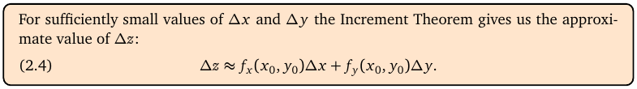
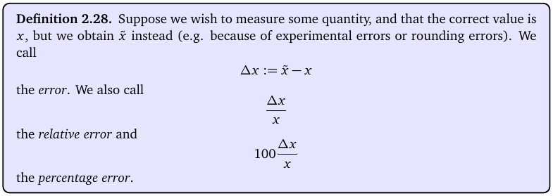
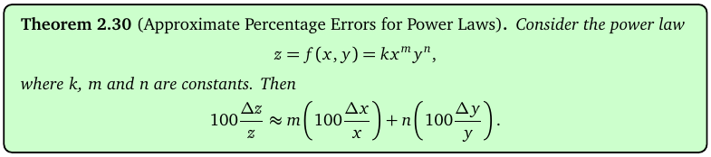
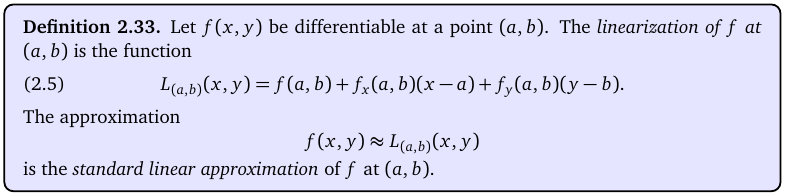
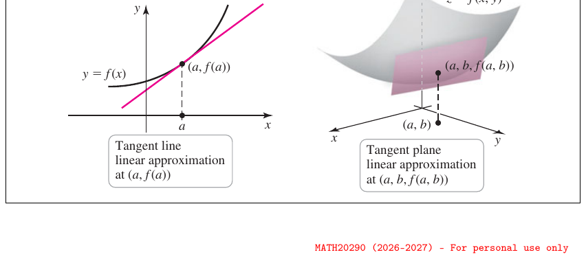

# Topic 7: Percentage errors and linear approximation

Tutorial questions: Sheet 2 Q9, Q10, Q11, Q12 · Sample exam Q3(c)

Notes pages: 28 to 32 (§2.8 to §2.10)

---

## The big idea

Near a point, a smooth surface looks almost flat, like its tangent plane.

So a small change in the inputs gives a change in the output of about:

$$\Delta z \approx f_x\,\Delta x + f_y\,\Delta y$$

Two uses:
1. **Errors:** if you measure x and y a bit wrong, how wrong is z? (As a percentage.)
2. **Approximation:** estimate an ugly number like √(1.02² + 2.01³) without a calculator.

---

**How to use these notes:**
When you see 🧠, stop.
Answer it on paper first.
Then click to check.

---

## ⭐ Learn by heart from this topic

**Small change:**

$$\Delta z \approx f_x\,\Delta x + f_y\,\Delta y$$

**Power law shortcut.** If $z = kx^m y^n$:

$$100\frac{\Delta z}{z} \approx m\left(100\frac{\Delta x}{x}\right) + n\left(100\frac{\Delta y}{y}\right)$$

**Linearisation at (a, b):**

$$L(x,y) = f(a,b) + f_x(a,b)(x-a) + f_y(a,b)(y-b)$$

**Memory hook:**
Power law: "percentage error = power × percentage change, added up."

---

## 1. The approximation formula

**How to read this box:**

For small Δx and Δy, the change in z is about $f_x\Delta x + f_y\Delta y$.

The partial derivatives are worked out at the starting point (x₀, y₀).

In one variable this is the first-year $\Delta y \approx f'(x)\Delta x$.

 

For three variables, add a term: $\Delta w \approx f_x\Delta x + f_y\Delta y + f_z\Delta z$.

---

## 2. Errors

**How to read this box:**

| Name | Formula | Meaning |
|---|---|---|
| error | $\Delta x = \tilde{x} - x$ | measured minus true |
| relative error | $\frac{\Delta x}{x}$ | error as a fraction |
| percentage error | $100\frac{\Delta x}{x}$ | error as a percent |

"x is overestimated by 0.5%" means $100\frac{\Delta x}{x} = +0.5$.

"z is underestimated by 1%" means $100\frac{\Delta z}{z} = -1$.

⚠️ **Sign trap:** over = **+**, under = **−**, increase = **+**, decrease = **−**.

---

## 3. The power law shortcut

**How to read this box:**

If z = k·xᵐ·yⁿ (a constant times powers), the percentage error in z is m times the % error in x plus n times the % error in y.

The constant k doesn't matter. It cancels.

It works for any number of variables, and for negative or fractional powers.

---

### 📐 Method: percentage error

| Step | Do this |
|---|---|
| 1 | Rewrite the formula as k × powers. Move things from the bottom up with negative powers: $\frac{kx}{z^4} = kxz^{-4}$, $\frac{1}{\sqrt{V}} = V^{-1/2}$. |
| 2 | Read off each power. |
| 3 | Write down each % change, with its sign. |
| 4 | % error in z = Σ (power × % change). |
| 5 | Say whether it's an increase (+) or decrease (−). |

**Use it when:**
"Find the approximate percentage error in …" and the formula is a product of powers.

**Do NOT use it when:**
The formula has a + or − between terms (like x + y). Then use $\Delta z \approx f_x\Delta x + f_y\Delta y$ and divide by z yourself.

 

**Example (notes Ex 2.31):** V = πr²h. Error 1% in r, 2% in h.

$100\frac{\Delta V}{V} \approx 2(1) + 1(2) = 4\%$.

 

### 🧠 Check
η = kx/z⁴. x is overestimated by 0.5%, z underestimated by 1%. % error in η?

Answer

η = kx¹z⁻⁴.

% error ≈ 1(0.5) + (−4)(−1) = 0.5 + 4 = **4.5%**.

(Sheet 2 Q9.)

---

## 4. Linear approximation

**How to read this box:**

- $L_{(a,b)}(x,y)$ is a flat (linear) function of x and y.
- It matches f exactly at (a, b).
- Near (a, b), f(x, y) ≈ L(x, y). This is the **standard linear approximation**.

 

**How to read this diagram:**

- Left (one variable): the pink tangent line hugs the curve y = f(x) near (a, f(a)).
- Right (two variables): the pink tangent plane hugs the surface z = f(x, y) near (a, b, f(a, b)).
- L(x, y) is the height of that tangent plane. Close to (a, b), it's almost the same as the surface.

---

### 📐 Method: estimate a number with linear approximation

| Step | Do this |
|---|---|
| 1 | Spot the function f(x, y) hiding in the number. |
| 2 | Pick a **nice** point (a, b) close to the numbers, where f is easy (whole numbers, perfect squares). |
| 3 | Find f(a, b), $f_x(a, b)$, $f_y(a, b)$. |
| 4 | Write L(x, y) = f(a,b) + f_x(a,b)(x − a) + f_y(a,b)(y − b). |
| 5 | Plug the ugly numbers into L. |

**Use it when:**
"Use linear approximation to find an approximate value of …"

 

### 🧠 Check
To estimate $\sqrt{(2.01)^3 + (2.98)^2}$, which f and which nice point?

Answer

$f(x,y) = (x^3+y^2)^{1/2}$ at (2, 3), where f = √(8 + 9) = √17.

(Notes Ex 2.36 uses $(x^4 + y^2)^{1/2}$ with 2.01⁴; same idea: pick the whole-number point next to the data.)

---

## 5. Worked example (Sheet 2 Q11)

Estimate $\sqrt{(1.02)^2 + (2.01)^3}$.

**Step 1:** f(x, y) = (x² + y³)^(1/2).

**Step 2:** nice point (1, 2). f(1, 2) = √(1 + 8) = 3.

**Step 3:** $f_x = x(x^2+y^3)^{-1/2}$, so $f_x(1,2) = \frac13$.

$f_y = \frac32 y^2(x^2+y^3)^{-1/2}$, so $f_y(1,2) = \frac32 \cdot 4 \cdot \frac13 = 2$.

**Step 4:** $L(x,y) = 3 + \frac13(x-1) + 2(y-2)$.

**Step 5:** $L(1.02, 2.01) = 3 + \frac{0.02}{3} + 0.02 = 3.0267 \approx 3.03$.

Official answer: 3.03.

---

## 6. Worked example (Sample exam Q3 c)

L = 4πR²σT⁴. R up 4%, T down 1%. % error in L?

Powers: R², T⁴. (4π and σ are constants.)

$$100\frac{\Delta L}{L} \approx 2(4) + 4(-1) = 8 - 4 = 4$$

A **4% increase**. Matches the official answer.

---

## Method table

| You're asked for | Use |
|---|---|
| % error, formula is a product of powers | power law: Σ power × % change (§3) |
| % error, formula has + or − | Δz ≈ f_xΔx + f_yΔy, then ÷ z (§1) |
| an approximate value of an ugly number | linearise at a nice nearby point (§4) |
| the linearisation L(x, y) | f(a,b) + f_x(x − a) + f_y(y − b) (§4) |

---

Next: [End-of-topic test](../questions/07-errors-linear-approx.md)
