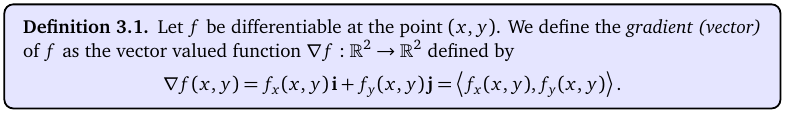
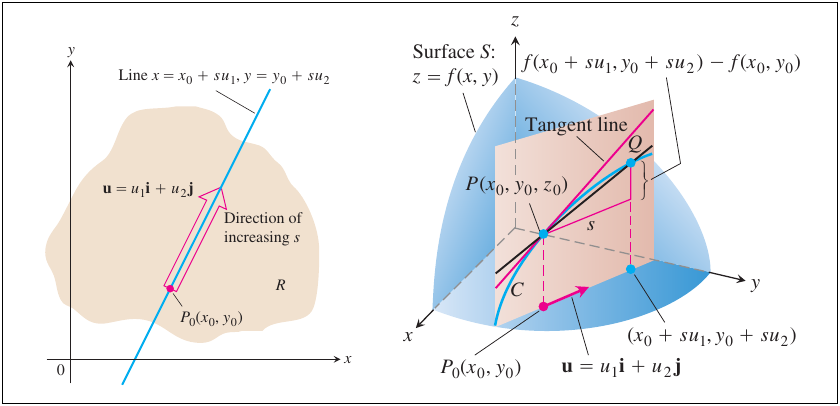
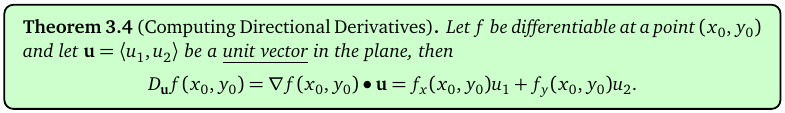
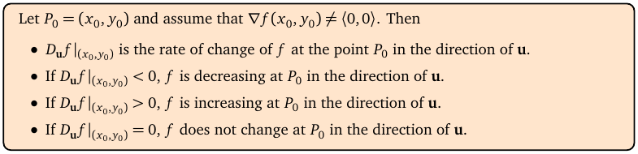
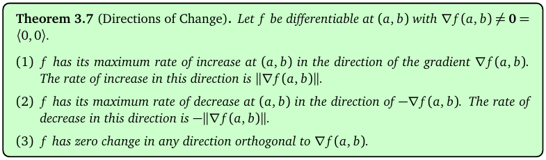
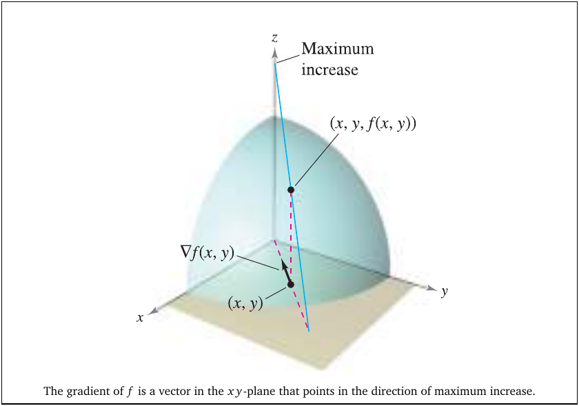
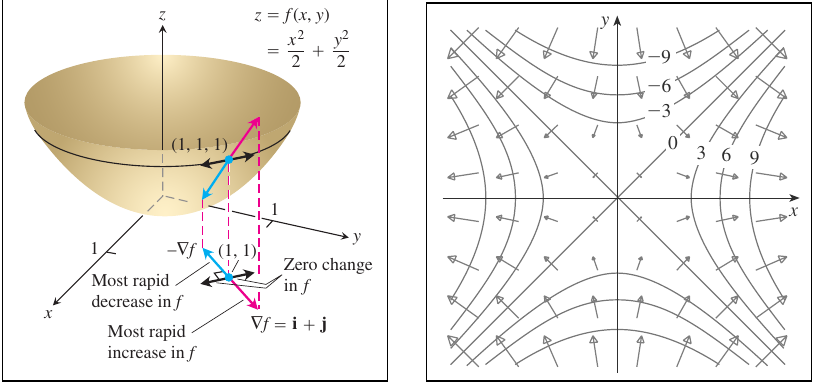
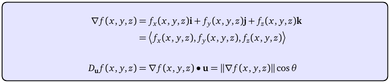
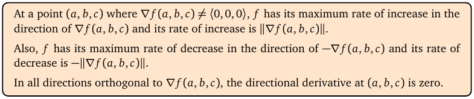
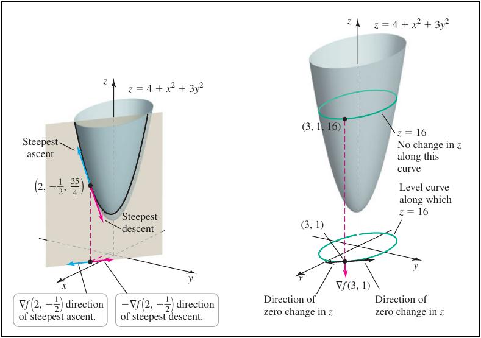

# Topic 8: Gradient, directional derivatives, steepest ascent

Tutorial questions: Sheet 3 Q1 to Q8 · Sample exam Q4 (all 5 parts)

Notes pages: 33 to 42 (§3.1 to §3.7)

---

## The big idea

$f_x$ and $f_y$ tell you the slope going east and going north.

But you can walk in **any** direction u.

The slope in direction u is the **directional derivative** $D_{\mathbf u}f$.

You get it from one vector, the **gradient** ∇f = ⟨f_x, f_y⟩:

$$D_{\mathbf u}f = \nabla f \cdot \mathbf{u}$$

And the gradient points **straight uphill**: the direction where f increases fastest.

A whole exam question (Q4, 5 parts) is just this topic.

---

**How to use these notes:**
When you see 🧠, stop.
Answer it on paper first.
Then click to check.

---

## ⭐ Learn by heart from this topic

$$\nabla f = \langle f_x, f_y \rangle \quad\text{or}\quad \langle f_x, f_y, f_z \rangle$$

$$D_{\mathbf u}f = \nabla f \cdot \mathbf u \qquad \mathbf u \text{ must be a UNIT vector}$$

$$\mathbf u = \frac{\mathbf v}{\|\mathbf v\|} \qquad \|\langle a, b, c\rangle\| = \sqrt{a^2+b^2+c^2}$$

| Question | Direction | Rate |
|---|---|---|
| fastest increase | $\nabla f$ | $\|\nabla f\|$ |
| fastest decrease | $-\nabla f$ | $-\|\nabla f\|$ |
| no change | any u with $\nabla f \cdot \mathbf u = 0$ | 0 |

**Memory hook:**
"Gradient goes uphill. Its length is how steep."

Trick for 2D: ⟨a, b⟩ is orthogonal to ⟨b, −a⟩ and ⟨−b, a⟩.

---

## 1. Dot product and unit vectors (recap)

$$\langle v_1, v_2, v_3 \rangle \cdot \langle w_1, w_2, w_3 \rangle = v_1w_1 + v_2w_2 + v_3w_3$$

$$\mathbf v \cdot \mathbf w = \|\mathbf v\|\,\|\mathbf w\|\cos\theta$$

- **Orthogonal** (perpendicular) ⇔ dot product = 0.
- A **unit vector** has length 1.
- To make a unit vector in the direction of v, divide by its length.

 

### 🧠 Check
Make v = ⟨3, −4⟩ into a unit vector.

Answer

‖v‖ = √(9 + 16) = 5.

u = ⟨3/5, −4/5⟩.

---

## 2. The gradient

**How to read this box:**

- ∇f ("nabla f", or "grad f") is a vector.
- Its parts are the partial derivatives: ⟨f_x, f_y⟩.
- For three variables add f_z: ⟨f_x, f_y, f_z⟩.

 

### 🧠 Check
f = ln(x² + y²). Find ∇f(1, 1).

Answer

$\nabla f = \left\langle \frac{2x}{x^2+y^2}, \frac{2y}{x^2+y^2} \right\rangle$

∇f(1, 1) = ⟨1, 1⟩. (Sheet 3 Q1b.)

---

## 3. The directional derivative

**How to read this diagram:**

- Left: the floor (xy-plane). From the point P₀ you walk along the blue line in the direction of the unit vector u.
- Right: above that line, the surface z = f(x, y) is sliced by a vertical plane (pink). The slice is a curve C.
- The tangent line to C at P is the steepness you feel walking in direction u.
- That slope is the directional derivative $D_{\mathbf u}f(x_0, y_0)$.

 

**How to read this box:**

- You don't need the limit definition.
- Just dot the gradient with the unit vector: $D_{\mathbf u}f = \nabla f \cdot \mathbf u = f_xu_1 + f_yu_2$.

 

**How to read this box:**

| $D_{\mathbf u}f$ is | f is … in direction u |
|---|---|
| < 0 | decreasing |
| > 0 | increasing |
| = 0 | not changing |

$f_x$ and $f_y$ are just $D_{\mathbf i}f$ and $D_{\mathbf j}f$.

---

### 📐 Method: directional derivative

| Step | Do this |
|---|---|
| 1 | Find ∇f as a formula. |
| 2 | Put the point in: ∇f(P). |
| 3 | Is the direction vector v a unit vector? If not, u = v / ‖v‖. |
| 4 | "From P towards Q": v = Q − P (coordinates of Q minus coordinates of P). |
| 5 | $D_{\mathbf u}f(P) = \nabla f(P) \cdot \mathbf u$. |
| 6 | Say what the sign means if asked ("decreasing in that direction"). |

**Use it when:**
"Find the directional derivative / rate of change in the direction of …".

⚠️ **The #1 mistake:** forgetting to make v a unit vector.

 

### 🧠 Check
f = 2xy − 3y², P₀ = (5, 5), v = ⟨4, 3⟩. Find $D_{\mathbf u}f(P_0)$.

Answer

∇f = ⟨2y, 2x − 6y⟩. ∇f(5, 5) = ⟨10, −20⟩.

‖v‖ = 5, u = ⟨4/5, 3/5⟩.

D_u f = 10(4/5) − 20(3/5) = 8 − 12 = **−4**. (Sheet 3 Q2a.)

---

## 4. Fastest increase, fastest decrease, no change

**How to read this box:**

At a point where ∇f ≠ 0:
1. f increases fastest in the direction of ∇f. The rate is ‖∇f‖.
2. f decreases fastest in the direction of −∇f. The rate is −‖∇f‖.
3. f doesn't change in any direction orthogonal to ∇f.

 

**Why (one line):** $D_{\mathbf u}f = \|\nabla f\|\,\|\mathbf u\|\cos\theta = \|\nabla f\|\cos\theta$. cos θ is biggest (1) at θ = 0, smallest (−1) at θ = 180°, and 0 at 90°.

 

**How to read this diagram:**

- The dome is the surface z = f(x, y).
- On the floor, at the point (x, y), the vector ∇f(x, y) points one way.
- Straight above it, the path up the dome in that direction is the **steepest** ("Maximum increase").
- The gradient lives on the floor (xy-plane), not on the surface.

 

**How to read this diagram:**

- Left: the bowl $z = \frac{x^2}{2} + \frac{y^2}{2}$ at the point (1, 1).
- ∇f = i + j (pink) points to "most rapid increase". −∇f points to "most rapid decrease".
- The two blue directions, at right angles to ∇f, give "zero change".
- Right: a gradient field. The arrows always cross the level curves at right angles (more in Topic 9).

---

### 📐 Method: directions of change

| Asked for | Answer |
|---|---|
| direction of fastest increase | $\mathbf u = \frac{\nabla f(P)}{\|\nabla f(P)\|}$ (or just "the direction of ∇f(P)") |
| maximum rate of increase | $\|\nabla f(P)\|$ |
| direction of fastest decrease | $-\mathbf u$ |
| that rate | $-\|\nabla f(P)\|$ |
| directions of zero change (2D) | if ∇f(P) = ⟨a, b⟩: ±⟨b, −a⟩ / ‖⟨a, b⟩‖ |
| "is there a direction with rate 14?" | only if \|14\| ≤ ‖∇f(P)‖ |

 

### 🧠 Check
∇f(3, 2) = ⟨2, 7⟩. Give the two unit directions where $D_{\mathbf u}f = 0$.

Answer

Orthogonal vector: ⟨7, −2⟩, length √53.

$\mathbf u = \left\langle \frac{7}{\sqrt{53}}, -\frac{2}{\sqrt{53}} \right\rangle$ and $-\mathbf u$. (Sheet 3 Q4.)

---

## 5. Three variables

**How to read this box:**

Exactly the same formulas, with a third component.

$D_{\mathbf u}f = \nabla f \cdot \mathbf u = \|\nabla f\|\cos\theta$.

 

**How to read this box:**

Fastest increase along ∇f(a, b, c), rate ‖∇f‖. Fastest decrease along −∇f. Zero in every direction orthogonal to ∇f (now a whole plane of directions).

 

**How to read this diagram:**

- z = 4 + x² + 3y², at the point above (2, −1/2).
- ∇f(2, −1/2) on the floor points the way of steepest ascent. −∇f points down the steepest way.
- Right: along the green level curve z = 16 the height doesn't change. Directions tangent to it give zero change.

---

## 6. Worked example (Sample exam Q4)

$T(x,y,z) = e^{x^2-4y^2-9z^2}$, P = (2, −1, 0), Q = (3, −3, 3).

**(a) Gradient at P.**

$$\nabla T = e^{x^2-4y^2-9z^2}\langle 2x, -8y, -18z \rangle$$

At P the exponent is 4 − 4 − 0 = 0, so e⁰ = 1.

$$\nabla T(P) = \langle 4, 8, 0 \rangle$$

**(b) Unit vector from P towards Q.**

v = Q − P = ⟨1, −2, 3⟩. ‖v‖ = √14.

$$\mathbf u = \frac{1}{\sqrt{14}}\langle 1, -2, 3 \rangle$$

**(c) Rate of change at P towards Q.**

$$D_{\mathbf u}T(P) = \frac{1}{\sqrt{14}}(4 - 16 + 0) = -\frac{12}{\sqrt{14}}$$

(Leave it exact. Temperature is falling that way.)

**(d) Direction of fastest increase:** the direction of ∇T(P) = ⟨4, 8, 0⟩.

**(e) Maximum rate:** $\|\langle 4, 8, 0\rangle\| = \sqrt{80} = 4\sqrt5$.

All match the official answers.

---

## Method table

| You're asked for | Use |
|---|---|
| the gradient | ⟨f_x, f_y, f_z⟩ at the point (§2) |
| a unit vector from P towards Q | (Q − P) / ‖Q − P‖ (§3) |
| rate of change in a direction | ∇f · u, u a unit vector (§3) |
| direction of fastest increase / decrease | ±∇f (§4) |
| max rate of increase | ‖∇f‖ (§4) |
| directions of zero change | orthogonal to ∇f (§4) |
| "can the rate be k?" | yes only if \|k\| ≤ ‖∇f‖ (§4) |
| ∇f from two directional derivatives | write ∇f = ⟨r, s⟩, two equations, solve (§4) |

---

Next: [End-of-topic test](../questions/08-gradient-directional.md)
