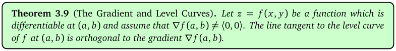
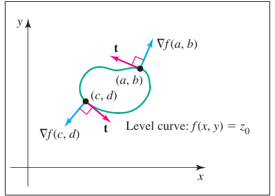
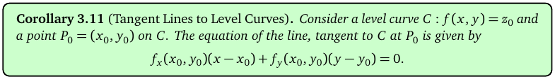
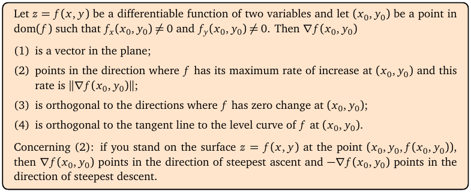
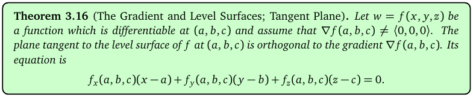
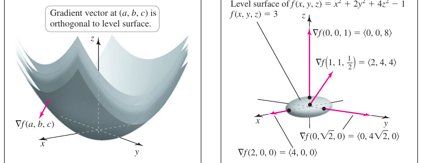
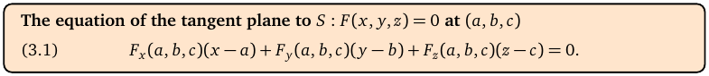
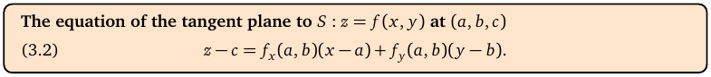
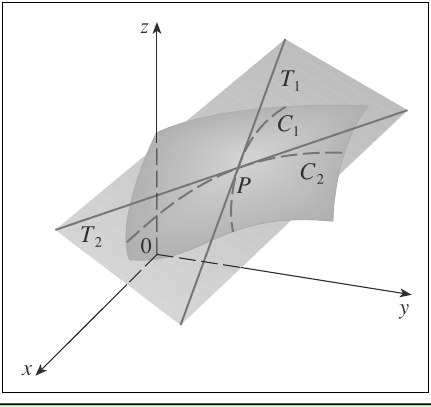

# Topic 9: Tangent lines and tangent planes

Tutorial questions: Sheet 3 Q9, Q10 · Sample exam Q5(a)

Notes pages: 21 (§2.4), 38 to 45 (§3.5, §3.8, §3.9)

---

## The big idea

The gradient is always **at right angles** to the level curve (or level surface) through the point.

So the gradient is a ready-made **normal vector**.

A normal vector + a point = the equation of a line (in 2D) or a plane (in 3D).

That's the whole topic. One formula, used twice.

---

**How to use these notes:**
When you see 🧠, stop.
Answer it on paper first.
Then click to check.

---

## ⭐ Learn by heart from this topic

**Tangent line** to the curve f(x, y) = c at (x₀, y₀):

$$f_x(x_0,y_0)(x-x_0) + f_y(x_0,y_0)(y-y_0) = 0$$

**Tangent plane** to the surface F(x, y, z) = c at (a, b, c):

$$F_x(x-a) + F_y(y-b) + F_z(z-c) = 0$$

**Tangent plane** to z = f(x, y) at (a, b, c), with c = f(a, b):

$$z - c = f_x(a,b)(x-a) + f_y(a,b)(y-b)$$

**Memory hook:**
"∇F at the point · (x − point) = 0."

---

## 1. Gradient ⟂ level curve

**How to read this box:**

At a point (a, b) where ∇f ≠ 0, the tangent line to the level curve through (a, b) is at right angles to ∇f(a, b).

 

**How to read this diagram:**

- The green loop is a level curve f(x, y) = z₀.
- At (a, b) the pink arrow t is tangent to the curve.
- The blue arrow ∇f(a, b) points out of the curve at a right angle to t.
- Same at (c, d): ∇f(c, d) is perpendicular to the curve there.

**Why:** along the level curve f doesn't change, so the directional derivative along t is 0. That means ∇f · t = 0 (Topic 8).

---

## 2. Tangent lines

**How to read this box:**

The tangent line to the level curve f(x, y) = z₀ at P₀ = (x₀, y₀) is

$f_x(x_0, y_0)(x - x_0) + f_y(x_0, y_0)(y - y_0) = 0$.

It's the line through P₀ with normal vector ∇f(P₀).

 

**Every curve in the plane is a level curve of something.** So: move everything to one side, call it f, and use the formula.

 

**How to read this box:**

Everything about ∇f(x₀, y₀) in one place: it's a vector in the plane (1), it points the way of fastest increase with rate ‖∇f‖ (2), it's orthogonal to the zero-change directions (3) and to the tangent line of the level curve (4). On the surface itself, ∇f points along steepest ascent.

---

### 📐 Method: tangent line to a curve

| Step | Do this |
|---|---|
| 1 | Write the curve as f(x, y) = constant. |
| 2 | Find ∇f = ⟨f_x, f_y⟩ and evaluate at the point. Call it ⟨a, b⟩. |
| 3 | Write a(x − x₀) + b(y − y₀) = 0. |
| 4 | Simplify (divide by common factors, collect terms). |

**Use it when:**
"Find the equation of the tangent line to the curve … at …"

 

### 🧠 Check
The ellipse x²/4 + y² = 2 at (−2, 1). Find the tangent line (notes Ex 3.12).

Answer

f = x²/4 + y². ∇f = ⟨x/2, 2y⟩ → ⟨−1, 2⟩.

−1(x + 2) + 2(y − 1) = 0, so **x − 2y = −4**.

---

## 3. Gradient ⟂ level surface

**How to read this box:**

For w = f(x, y, z), the gradient ∇f(a, b, c) is orthogonal to the level surface through (a, b, c).

So the tangent plane there is $f_x(x-a) + f_y(y-b) + f_z(z-c) = 0$.

 

**How to read this diagram:**

- Left: a stack of bowl-shaped level surfaces. The pink arrow ∇f(a, b, c) sticks out of one of them at right angles.
- Right: the level surface x² + 2y² + 4z² = 3 is an egg shape.
- At different points on it the gradient vectors (pink) all point straight out of the surface.
- E.g. at (0, 0, 1): ∇f = ⟨0, 0, 8⟩, straight up. At (2, 0, 0): ⟨4, 0, 0⟩, straight out along x.

---

## 4. Tangent planes

**How to read this box:**

For a surface given **implicitly**, F(x, y, z) = 0 (or = c), the tangent plane at (a, b, c) is

$F_x(a,b,c)(x-a) + F_y(a,b,c)(y-b) + F_z(a,b,c)(z-c) = 0$.

 

**How to read this box:**

For a surface given **explicitly**, z = f(x, y), the tangent plane at (a, b, c) is

$z - c = f_x(a,b)(x-a) + f_y(a,b)(y-b)$.

It comes from the first one with F = f(x, y) − z, so F_z = −1.

 

**How to read this diagram:**

- The curved sheet is the surface. P is the point.
- C₁ and C₂ are curves on the surface through P (the x-slice and y-slice from Topic 4).
- T₁ and T₂ are their tangent lines.
- The flat plane holding both T₁ and T₂ is the **tangent plane** at P.
- Its height is the linearisation L(x, y) from Topic 7.

---

### 📐 Method: tangent plane to a surface

| Step | Do this |
|---|---|
| 1 | Implicit? Move everything to one side: F(x, y, z) = c. |
| 2 | Find ∇F = ⟨F_x, F_y, F_z⟩ and put the point in. Call it ⟨A, B, C⟩. |
| 3 | Write A(x − a) + B(y − b) + C(z − c) = 0. |
| 4 | Expand and tidy into Ax + By + Cz = number. Divide out common factors. |
| (alt) | Explicit z = f(x, y)? Use z − c = f_x(x − a) + f_y(y − b). |

**Use it when:**
"Find the equation of the tangent plane to … at …"

**Check:** the point must satisfy your final equation. Plug it in.

 

### 🧠 Check
Sphere x² + y² + z² = r² at (a, b, c). Tangent plane? (Notes Ex 3.17.)

Answer

∇F = ⟨2a, 2b, 2c⟩.

2a(x − a) + 2b(y − b) + 2c(z − c) = 0

ax + by + cz = a² + b² + c² = **r²**.

---

## 5. Worked example (Sample exam Q5 a)

The level surface cos(x + 2y + 3z) = 0 at Q = (π/2, π, π).

**Step 1:** F = cos(x + 2y + 3z).

**Step 2:** ∇F = −sin(x + 2y + 3z)⟨1, 2, 3⟩.

At Q: x + 2y + 3z = π/2 + 2π + 3π = 11π/2. sin(11π/2) = sin(3π/2) = −1.

So ∇F(Q) = ⟨1, 2, 3⟩.

**Step 3:** (x − π/2) + 2(y − π) + 3(z − π) = 0.

**Step 4:** x + 2y + 3z = π/2 + 2π + 3π = **11π/2**.

Matches the official answer.

---

## Method table

| You're asked for | Use |
|---|---|
| tangent line to a curve f(x, y) = c | ∇f(P) · ⟨x − x₀, y − y₀⟩ = 0 (§2) |
| tangent plane to F(x, y, z) = c | ∇F(P) · ⟨x − a, y − b, z − c⟩ = 0 (§4) |
| tangent plane to z = f(x, y) | z − c = f_x(x − a) + f_y(y − b) (§4) |
| a normal vector to a surface | ∇F at the point (§3) |

---

Next: [End-of-topic test](../questions/09-tangent-lines-planes.md)
