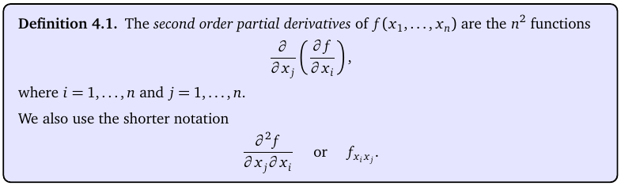
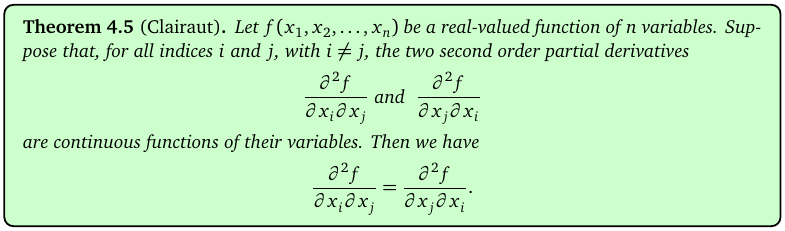
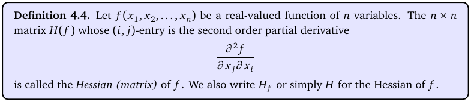
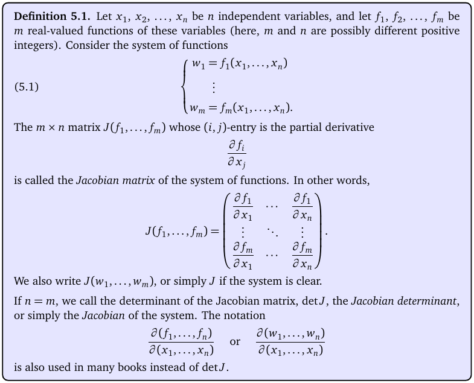
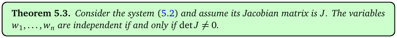

# Topic 10: Second partials, the Hessian matrix, the Jacobian matrix

Tutorial questions: Sheet 4 Q1 to Q6 · Sample exam Q3(b)

Notes pages: 47 to 49 (§4.1, §4.2), 55 to 57 (§5.1)

---

## The big idea

Two matrices built from partial derivatives. Don't mix them up.

- **Hessian H**: one function f, all its **second** partials. Used to classify critical points (Topics 11, 13).
- **Jacobian J**: several functions f₁, f₂, …, all their **first** partials. Its determinant tells you if the functions are independent.

Both are just careful bookkeeping. Get the layout right and you get the marks.

---

**How to use these notes:**
When you see 🧠, stop.
Answer it on paper first.
Then click to check.

---

## ⭐ Learn by heart from this topic

**Second partials:** $f_{xx} = (f_x)_x$, $f_{yy} = (f_y)_y$, $f_{xy} = (f_x)_y$.

**Clairaut:** $f_{xy} = f_{yx}$ (for any function you'll meet).

**Hessian** (2 and 3 variables):

$$H = \begin{pmatrix} f_{xx} & f_{xy} \\ f_{yx} & f_{yy} \end{pmatrix} \qquad H = \begin{pmatrix} f_{xx} & f_{xy} & f_{xz} \\ f_{yx} & f_{yy} & f_{yz} \\ f_{zx} & f_{zy} & f_{zz} \end{pmatrix}$$

**Jacobian** of f₁, …, fₘ in x₁, …, xₙ: row i = gradient of fᵢ.

$$J = \begin{pmatrix} \frac{\partial f_1}{\partial x_1} & \cdots & \frac{\partial f_1}{\partial x_n} \\ \vdots & & \vdots \\ \frac{\partial f_m}{\partial x_1} & \cdots & \frac{\partial f_m}{\partial x_n} \end{pmatrix}$$

**Determinants:**

$$\begin{vmatrix} a & b \\ c & d \end{vmatrix} = ad - bc$$

$$\begin{vmatrix} a & b & c \\ d & e & f \\ g & h & i \end{vmatrix} = a\begin{vmatrix} e & f \\ h & i \end{vmatrix} - b\begin{vmatrix} d & f \\ g & i \end{vmatrix} + c\begin{vmatrix} d & e \\ g & h \end{vmatrix}$$

**Memory hook:**
"Hessian = one f, second derivatives. Jacobian = many f's, first derivatives, one row per f."

---

## 1. Second order partial derivatives

**How to read this box:**

- Take a first partial, then take a partial of **that**.
- $\frac{\partial^2 f}{\partial x_j \partial x_i}$ means: first ∂/∂xᵢ, then ∂/∂xⱼ (read right to left).
- Short form: $f_{x_ix_j}$ means first xᵢ, then xⱼ (read left to right).
- A function of n variables has n² second partials.

 

For f(x, y) there are four: $f_{xx}$, $f_{yy}$, $f_{xy}$, $f_{yx}$.

 

**How to read this box:**

If the mixed second partials are continuous (always true for our functions), the order doesn't matter: $f_{x_ix_j} = f_{x_jx_i}$.

So you only need **three** for two variables: $f_{xx}$, $f_{yy}$, $f_{xy}$. Use $f_{yx}$ as a check.

 

### 🧠 Check
f = x²y³. Find $f_{xx}$, $f_{yy}$, $f_{xy}$.

Answer

$f_x = 2xy^3$, $f_y = 3x^2y^2$.

$f_{xx} = 2y^3$, $f_{yy} = 6x^2y$, $f_{xy} = 6xy^2$. (Sheet 4 Q1a.)

Check: $f_{yx} = (3x^2y^2)_x = 6xy^2$ ✓.

---

## 2. The Hessian matrix

**How to read this box:**

- H(f) is an n × n matrix.
- The entry in row i, column j is $\frac{\partial^2 f}{\partial x_i\partial x_j}$.
- Because of Clairaut, H is **symmetric** (mirror image across the diagonal).

---

### 📐 Method: Hessian

| Step | Do this |
|---|---|
| 1 | First partials: $f_x$, $f_y$ (and $f_z$). |
| 2 | Second partials: diagonal ones $f_{xx}$, $f_{yy}$, $f_{zz}$. |
| 3 | Mixed ones $f_{xy}$, $f_{xz}$, $f_{yz}$. Put each in **two** places (symmetric). |
| 4 | If a point is given, substitute **after** building H. |
| 5 | If asked, take the determinant. |

**Use it when:**
"Find the Hessian matrix", and in every critical-point question.

 

### 🧠 Check
f = eˣ sin y. Find H and det H. Can det H be 0?

Answer

$$H = \begin{pmatrix} e^x\sin y & e^x\cos y \\ e^x\cos y & -e^x\sin y \end{pmatrix}$$

det H = −e²ˣ sin² y − e²ˣ cos² y = **−e²ˣ**. Never 0, since e²ˣ > 0. (Sheet 4 Q3.)

---

## 3. The Jacobian matrix

**How to read this box:**

- You have m functions f₁, …, fₘ of n variables x₁, …, xₙ.
- The Jacobian J is m × n.
- Entry (i, j) = $\frac{\partial f_i}{\partial x_j}$: function i, variable j.
- So **row i is the gradient of fᵢ**.
- When m = n, det J is the **Jacobian determinant**, also written $\frac{\partial(f_1,\ldots,f_n)}{\partial(x_1,\ldots,x_n)}$.

 

**How to read this box:**

The functions w₁, …, wₙ are **independent** if and only if det J ≠ 0.

det J = 0 means there's a hidden relationship between them (notes Ex 5.4: w₁ = cos(x₁ + x₂) and w₂ = sin(x₁ + x₂) satisfy w₁² + w₂² = 1, and det J = 0 everywhere).

---

### 📐 Method: Jacobian

| Step | Do this |
|---|---|
| 1 | Write the functions down the left, one per row. |
| 2 | Write the variables across the top, one per column. |
| 3 | Fill row i with ∂fᵢ/∂x, ∂fᵢ/∂y, ∂fᵢ/∂z. |
| 4 | Substitute the point (if given). |
| 5 | Determinant: expand along the row or column with the most zeros. Pull common factors out of a row first. |

**Use it when:**
"Find the Jacobian matrix of this system", "evaluate the Jacobian determinant".

 

### 🧠 Check
f₁ = x₁² + x₂², f₂ = 2x₁x₂. Find J. When is det J = 0?

Answer

$$J = \begin{pmatrix} 2x_1 & 2x_2 \\ 2x_2 & 2x_1 \end{pmatrix}, \quad \det J = 4x_1^2 - 4x_2^2$$

det J = 0 ⟺ x₁² = x₂² ⟺ x₁ = ±x₂. (Sheet 4 Q5.)

---

## 4. Worked example (Sample exam Q3 b)

f₁ = x + 2y + 3z, f₂ = eʸ + eᶻ, f₃ = ln(xyz).

**(i) Jacobian.** Write ln(xyz) = ln x + ln y + ln z, so its partials are 1/x, 1/y, 1/z.

$$J = \begin{pmatrix} 1 & 2 & 3 \\ 0 & e^y & e^z \\ x^{-1} & y^{-1} & z^{-1} \end{pmatrix}$$

**(ii) det J at (1, 1, 1).**

$$\det J(1,1,1) = \begin{vmatrix} 1 & 2 & 3 \\ 0 & e & e \\ 1 & 1 & 1 \end{vmatrix} = e\begin{vmatrix} 1 & 2 & 3 \\ 0 & 1 & 1 \\ 1 & 1 & 1 \end{vmatrix}$$

(pulled e out of row 2). Expand down column 1:

$$= e\left(1\begin{vmatrix} 1 & 1 \\ 1 & 1 \end{vmatrix} + 1\begin{vmatrix} 2 & 3 \\ 1 & 1 \end{vmatrix}\right) = e(0 + (2 - 3)) = -e$$

Official answer: −e.

---

## Method table

| You're asked for | Use |
|---|---|
| $f_{xx}$, $f_{yy}$, $f_{xy}$ | differentiate twice; check $f_{xy} = f_{yx}$ (§1) |
| the Hessian | matrix of second partials, symmetric (§2) |
| the Jacobian matrix | row i = ∇fᵢ (§3) |
| the Jacobian determinant | expand along the row/column with most zeros (§3, §4) |
| are the functions independent? | det J ≠ 0 (§3) |

---

Next: [End-of-topic test](../questions/10-hessian-jacobian.md)
