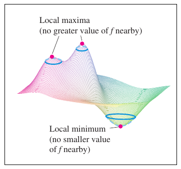
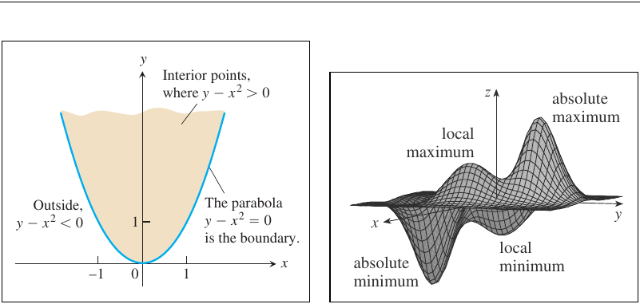
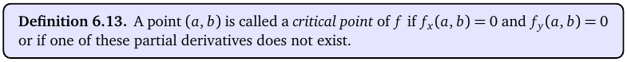
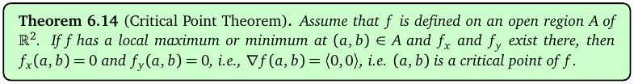
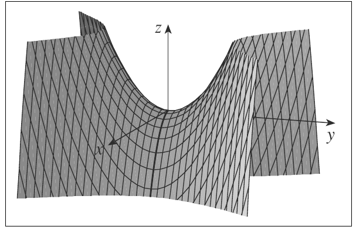
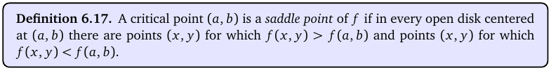
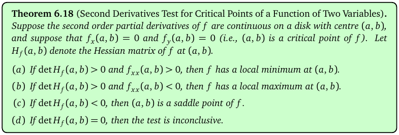
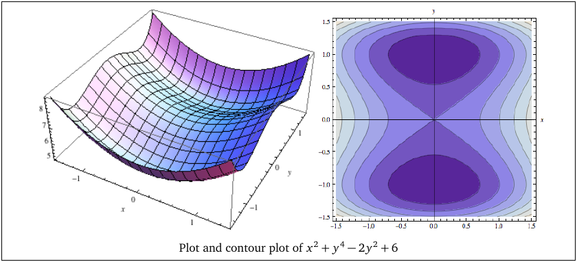

# Topic 11: Critical points and the second derivatives test (2 variables)

Tutorial questions: Sheet 4 Q7, Q8, Q12, Q13

Notes pages: 65 to 72 (§6.1, §6.3)

---

## The big idea

At the top of a hill or the bottom of a valley, the surface is flat: $f_x = 0$ and $f_y = 0$.

Points where that happens are **critical points**.

But flat doesn't always mean top or bottom. It could be a **saddle**: up one way, down the other.

To tell which, use the **second derivatives test**: look at the Hessian determinant D and at $f_{xx}$.

---

**How to use these notes:**
When you see 🧠, stop.
Answer it on paper first.
Then click to check.

---

## ⭐ Learn by heart from this topic

**Critical point:** $f_x = 0$ and $f_y = 0$ (solve together).

**Second derivatives test** at a critical point:

$$D = \det H = f_{xx}f_{yy} - f_{xy}^2$$

| D | $f_{xx}$ | Verdict |
|---|---|---|
| > 0 | > 0 | **local minimum** |
| > 0 | < 0 | **local maximum** |
| < 0 | any | **saddle point** |
| = 0 | any | test fails, look closer |

**Memory hook:**
"D negative → saddle. D positive → look at f_xx: positive = smiley (min), negative = frowny (max)."

---

## 1. Local and absolute extremes

**How to read this diagram:**

- The two pink dots on the peaks are **local maxima**: nothing nearby is higher.
- The pink dot in the dip is a **local minimum**: nothing nearby is lower.
- "Local" means compared with points **close by**, not the whole surface.

 

**How to read this diagram:**

- Right: a bumpy surface with several local maxima and minima.
- The highest of all is the **absolute maximum**. The lowest of all is the **absolute minimum**.
- An absolute max is also a local max, but not the other way round.
- (Left: a region in the plane, for Topic 12.)

---

## 2. Critical points

**How to read this box:**

(a, b) is a critical point if $f_x(a,b) = 0$ and $f_y(a,b) = 0$, **or** if one of them doesn't exist.

In this course, it's almost always the first case.

 

**How to read this box:**

If f has a local max or min at an interior point (a, b), then ∇f(a, b) = ⟨0, 0⟩.

So local extremes are **only** found at critical points. That's why you solve ∇f = 0 first.

The tangent plane there is flat (horizontal).

---

### 📐 Method: find the critical points

| Step | Do this |
|---|---|
| 1 | Find $f_x$ and $f_y$. |
| 2 | Set both = 0. |
| 3 | Factor each equation if you can (e.g. $y(y-1)(y+1) = 0$). |
| 4 | Solve one for a variable and substitute into the other. Or split into cases ("x = 0 or …"). |
| 5 | List **every** solution (x, y). Keep real ones only. |
| 6 | Check each is in the domain. |

⚠️ **Don't divide by a variable** that could be 0. Factor it out instead, or you lose solutions.

 

### 🧠 Check
f = x³ + y³ − 3xy. Find the critical points.

Answer

$f_x = 3x^2 - 3y = 0 \Rightarrow y = x^2$.

$f_y = 3y^2 - 3x = 0 \Rightarrow x = y^2 = x^4$.

$x^4 - x = x(x^3 - 1) = 0$, so x = 0 or x = 1.

Points: **(0, 0)** and **(1, 1)**. (Sheet 4 Q7a.)

---

## 3. Saddle points

**How to read this diagram:**

- The surface z = y² − x² (a "hyperbolic paraboloid").
- At the origin it's flat, so (0, 0) is a critical point.
- Along the y-direction it curves **up**: (0, 0) looks like a minimum.
- Along the x-direction it curves **down**: (0, 0) looks like a maximum.
- So it's neither. It's a **saddle point** (like a horse saddle).

 

**How to read this box:**

A critical point is a saddle if every disk around it has points higher than f(a, b) **and** points lower.

---

## 4. The second derivatives test

**How to read this box:**

At a critical point (a, b), with $H_f(a, b)$ the Hessian:

(a) det H > 0 and $f_{xx}$ > 0 → local minimum.

(b) det H > 0 and $f_{xx}$ < 0 → local maximum.

(c) det H < 0 → saddle point.

(d) det H = 0 → the test says nothing.

---

### 📐 Method: classify critical points

| Step | Do this |
|---|---|
| 1 | Find all critical points (§2). |
| 2 | Find $f_{xx}$, $f_{yy}$, $f_{xy}$ and write H as a formula. |
| 3 | Write D = det H = $f_{xx}f_{yy} - f_{xy}^2$ as a formula. |
| 4 | For each point: work out D, then $f_{xx}$ if D > 0. |
| 5 | Use the table. Make a little table of your own: point, D, $f_{xx}$, verdict. |
| 6 | If asked for the value: work out f at the point. |

**If D = 0:** try paths. E.g. look at f along y = 0 and along y = x near the point. If f is bigger on one path and smaller on another, it's a saddle.

 

**How to read this diagram:**

- Notes Example 6.19: f = x² + y⁴ − 2y² + 6.
- Critical points: (0, 0), (0, 1), (0, −1).
- D = 2(12y² − 4) = 24y² − 8. At (0, 0): D = −8 → saddle. At (0, ±1): D = 16 > 0, $f_{xx}$ = 2 > 0 → minima.
- The plot shows two dips (dark ovals in the contour plot, right) with a saddle between them.

 

### 🧠 Check
f = x² + 2y² − 4x + 4y. Find and classify the critical point.

Answer

$f_x = 2x - 4 = 0$, $f_y = 4y + 4 = 0$ → (2, −1).

$f_{xx} = 2$, $f_{yy} = 4$, $f_{xy} = 0$. D = 8 > 0, $f_{xx}$ > 0.

**(2, −1) is a local minimum.** (Sheet 4 Q8b.)

---

## 5. Worked example (Sheet 4 Q8 d)

$f = xy\,e^{-(x^2+y^2)/2}$.

**Critical points.** Product rule, with $E = e^{-(x^2+y^2)/2}$ (never 0):

$f_x = y(1 - x^2)E$, $\quad f_y = x(1 - y^2)E$.

$f_x = 0$: y = 0 or x = ±1. $f_y = 0$: x = 0 or y = ±1.

- y = 0 forces x = 0: **(0, 0)**.
- x = ±1 forces y = ±1: **(1, 1), (1, −1), (−1, 1), (−1, −1)**.

**Classify.** At (0, 0): $f_{xx} = f_{yy} = 0$, $f_{xy} = 1$. D = −1 < 0 → **saddle**.

At (±1, ±1): $f_{xy} = 0$ and $f_{xx} = f_{yy} = -2xy\,e^{-1}$. D = 4e⁻² > 0.

- xy = 1, i.e. (1, 1) and (−1, −1): $f_{xx} = -2/e < 0$ → **local max**, value 1/e.
- xy = −1, i.e. (1, −1) and (−1, 1): $f_{xx} = 2/e > 0$ → **local min**, value −1/e.

(The short answers on Sheet 4 forget (−1, 1). It's a local min too, by symmetry.)

---

## Method table

| You're asked for | Use |
|---|---|
| critical points | solve $f_x = 0$, $f_y = 0$ together (§2) |
| classify them (2 variables) | D = $f_{xx}f_{yy} - f_{xy}^2$ and $f_{xx}$ (§4) |
| D = 0 | test fails: check f along two paths (§4) |
| local max/min value | f at the point (§4) |

---

Next: [End-of-topic test](../questions/11-critical-points-2var.md)
