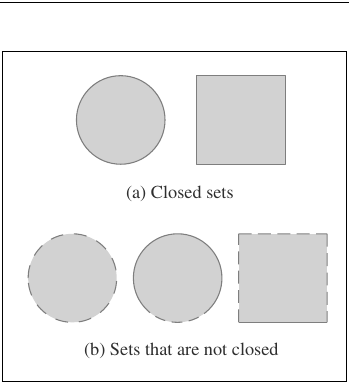
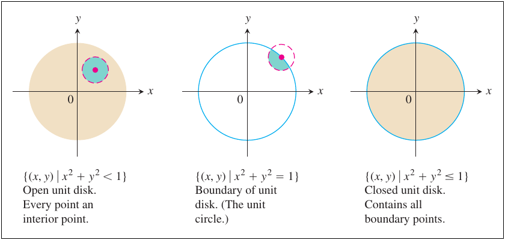
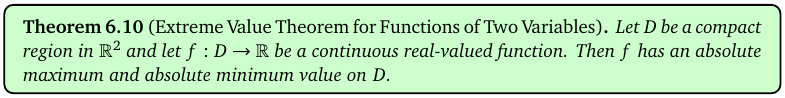
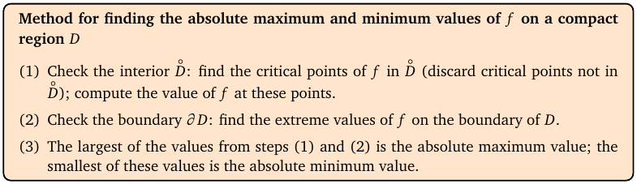
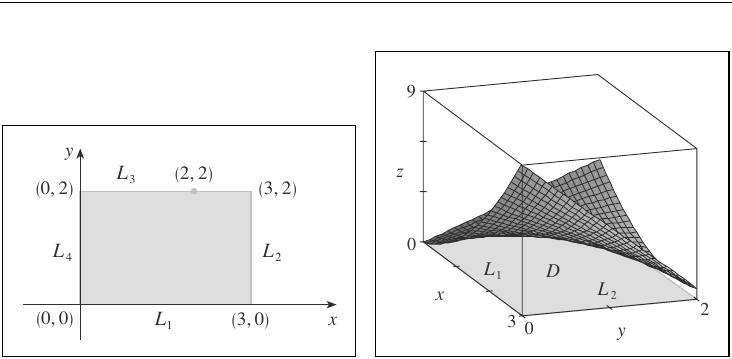
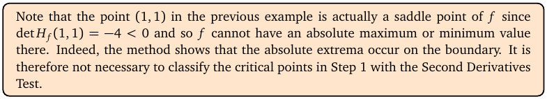

# Topic 12: Absolute maximum and minimum on a closed region

Tutorial questions: Sheet 4 Q14

Notes pages: 65 to 75 (§6.2, end of §6.3)

---

## The big idea

Now f lives on a fenced-off region D (a disk, a square…), and you want the **highest and lowest values on all of D**.

If D is closed and bounded, those values definitely exist.

They can only be in two places:
1. at a critical point **inside** D, or
2. somewhere on the **fence** (the boundary).

So: check both, list all the candidate values, pick the biggest and smallest.

---

**How to use these notes:**
When you see 🧠, stop.
Answer it on paper first.
Then click to check.

---

## ⭐ Learn by heart from this topic

**Extreme Value Theorem:** a continuous f on a **compact** (closed and bounded) region D has an absolute max and an absolute min on D.

**The 3-step method:**
1. Interior: critical points inside D → values of f.
2. Boundary: f restricted to the boundary → its biggest and smallest values.
3. Compare. Largest = absolute max. Smallest = absolute min.

**Memory hook:**
"Inside, fence, compare."

You do **not** need the second derivatives test here. Just compare numbers.

---

## 1. Regions: open, closed, bounded, compact

**How to read this diagram:**

- (a) Closed sets: solid edges. The boundary belongs to the set.
- (b) Not closed: dashed edges. Some or all of the boundary is missing.

 

**How to read this diagram:**

- Left: the **open** unit disk x² + y² < 1. Every point has a little disk around it that stays inside (blue). Edge not included.
- Middle: the **boundary**, the circle x² + y² = 1. Any little disk around a boundary point pokes outside (pink dashed).
- Right: the **closed** unit disk x² + y² ≤ 1 = inside + boundary.

 

| Word | Means |
|---|---|
| interior point | has a small disk around it that stays in D |
| boundary point | every small disk around it has points in D and points not in D |
| closed | contains all its boundary points |
| bounded | fits inside some big disk |
| **compact** | closed **and** bounded |

Examples: the closed unit disk and the unit square 0 ≤ x, y ≤ 1 are compact. The whole plane ℝ² is closed but not bounded, so not compact.

 

### 🧠 Check
Is {(x, y) | x² + y² < 4} compact?

Answer

No. It's bounded but **not closed** (the circle x² + y² = 4 is missing).

---

## 2. The Extreme Value Theorem

**How to read this box:**

If D is compact and f is continuous on D, then f **has** an absolute max and an absolute min on D.

It tells you they exist. It doesn't tell you where. That's what the method is for.

---

## 3. The method

**How to read this box:**

1. Check the interior: find the critical points of f inside D (throw away any outside), and work out f there.
2. Check the boundary: find the biggest and smallest values of f on the boundary ∂D.
3. The biggest number from steps 1 and 2 is the absolute max. The smallest is the absolute min.

---

### 📐 Method: absolute max and min on D

| Step | Do this |
|---|---|
| 1 | Solve $f_x = f_y = 0$. Keep only points **strictly inside** D. Work out f at each. |
| 2 | Split the boundary into pieces (4 sides of a square, or one circle). |
| 3 | On each piece, write f as a function of **one** variable (substitute the edge equation). |
| 4 | Find that function's max and min on its interval: set the derivative to 0, **and** check the endpoints (corners). |
| 5 | Collect all candidate values in a table. |
| 6 | Biggest = absolute max, smallest = absolute min. Give the points. |

**For a circle x² + y² = 1:** substitute y² = 1 − x², with −1 ≤ x ≤ 1. (Or use Lagrange, Topic 14.)

**Use it when:**
"Find the absolute max and min of f on D" or "find the hottest and coldest points on the plate".

 

**How to read this diagram:**

- Left: the rectangle D with corners (0,0), (3,0), (3,2), (0,2). Its boundary is four line segments L₁, L₂, L₃, L₄.
- Right: the surface z = x² − 2xy + 2y over D. The highest corner is at (3, 0).
- Interior critical point: (1, 1), f = 1.
- On each edge f becomes a one-variable function. E.g. on L₁ (y = 0) f = x², max 9 at x = 3.
- Comparing everything: absolute max **9** at (3, 0), absolute min **0** at (0, 0) and (2, 2).

 

**How to read this box:**

The point (1, 1) above is actually a saddle. It doesn't matter: you don't classify. You just put its value in the comparison.

 

### 🧠 Check
f = x² − y² + xy on the unit square. The only interior candidate is … ? (Notes Ex 6.23.)

Answer

$f_x = 2x + y = 0$, $f_y = -2y + x = 0$ gives (0, 0), which is a **corner**, not inside.

So no interior candidates. The extremes are on the boundary (max 5/4 at (1, 1/2), min −1 at (0, 1)).

---

## 4. Worked example (Sheet 4 Q14)

Plate: x² + y² ≤ 1. Temperature T = x² + 2y² − x. Hottest and coldest points?

**Step 1: interior.** $T_x = 2x - 1 = 0$, $T_y = 4y = 0$. Point (1/2, 0): inside (1/4 < 1). T = 1/4 − 1/2 = **−1/4**.

**Step 2: boundary.** On x² + y² = 1, put y² = 1 − x²:

$$T = x^2 + 2(1 - x^2) - x = 2 - x^2 - x, \qquad -1 \leq x \leq 1$$

Derivative −2x − 1 = 0 at x = −1/2. T = 2 − 1/4 + 1/2 = **9/4**. Then y² = 3/4, y = ±√3/2.

Endpoints: x = 1 (point (1, 0)): T = **0**. x = −1 (point (−1, 0)): T = **2**.

**Step 3: compare.**

| Point | T |
|---|---|
| (1/2, 0) | −1/4 |
| (−1/2, ±√3/2) | 9/4 |
| (1, 0) | 0 |
| (−1, 0) | 2 |

Hottest: **(−1/2, ±√3/2), T = 9/4**. Coldest: **(1/2, 0), T = −1/4**.

Matches the Sheet 4 short answer.

---

## Method table

| You're asked for | Use |
|---|---|
| does an absolute max/min exist? | Extreme Value Theorem: compact + continuous (§2) |
| absolute max/min on a region | inside, fence, compare (§3) |
| f on a straight edge | substitute the edge (e.g. y = 0), one-variable calculus, check corners (§3) |
| f on a circle | substitute y² = r² − x², check x = ±r (§4), or Lagrange (Topic 14) |

---

Next: [End-of-topic test](../questions/12-absolute-extrema.md)
