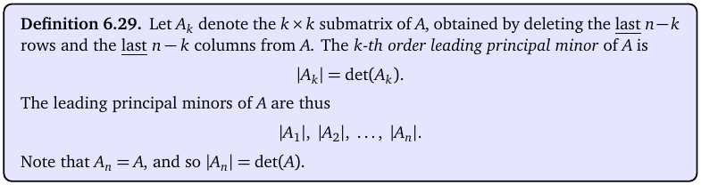
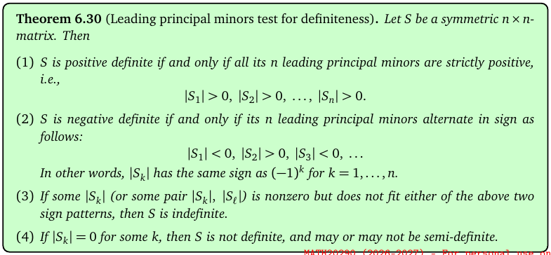
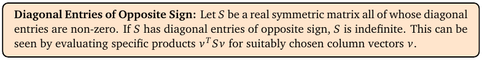
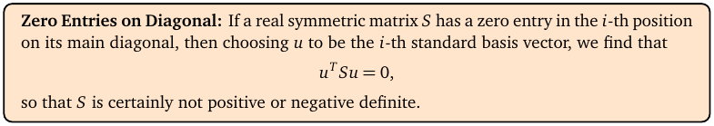
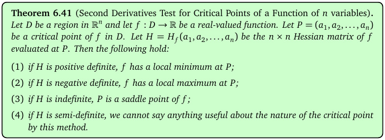
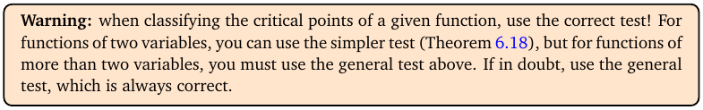

# Topic 13: Critical points in 3 or more variables (leading principal minors)

Tutorial questions: Sheet 4 Q9, Q10, Q11 · Sample exam Q5(b)

Notes pages: 76 to 85 (§6.4, §6.5)

---

## The big idea

For f(x, y, z), critical points are still where ∇f = 0 (now three equations).

To classify them you can't use "D and f_xx" any more. Instead you look at the **leading principal minors** of the 3 × 3 Hessian: the determinants of its top-left 1 × 1, 2 × 2 and 3 × 3 corners.

Their **sign pattern** tells you min, max or saddle.

The sample exam Q5(b) is exactly this, in three parts.

---

**How to use these notes:**
When you see 🧠, stop.
Answer it on paper first.
Then click to check.

---

## ⭐ Learn by heart from this topic

**Leading principal minors** of H:

$$|H_1| = f_{xx}, \qquad |H_2| = \begin{vmatrix} f_{xx} & f_{xy} \\ f_{yx} & f_{yy} \end{vmatrix}, \qquad |H_3| = \det H$$

| Signs of $\Vert H_1\Vert , \Vert H_2\Vert , \Vert H_3\Vert $ | H is | Critical point is |
|---|---|---|
| + + + | positive definite | **local minimum** |
| − + − | negative definite | **local maximum** |
| all ≠ 0, any other pattern | indefinite | **saddle point** |
| some = 0 | can't tell | test fails |

**Memory hook:**
"All plus = min. Alternate starting minus = max. Anything else (non-zero) = saddle."

For max, the sign of $|H_k|$ is the sign of $(-1)^k$: odd k negative, even k positive.

---

## 1. Leading principal minors

**How to read this box:**

- $A_k$ = the top-left k × k block of the matrix (delete the last n − k rows and columns).
- $|A_k|$ = its determinant. That's the k-th leading principal minor.
- For a 3 × 3 matrix there are three: $|A_1|$ (just the top-left number), $|A_2|$, $|A_3|$ = det A.

 

### 🧠 Check
Find the leading principal minors of

$$S = \begin{pmatrix} 2 & 3 & 1 \\ 3 & 5 & 1 \\ 1 & 1 & 3 \end{pmatrix}$$

Answer

$|S_1| = 2$.

$|S_2| = 2\cdot5 - 3\cdot3 = 1$.

$|S_3| = 2(15 - 1) - 3(9 - 1) + 1(3 - 5) = 28 - 24 - 2 = 2$.

All positive: S is positive definite. (Notes Ex 6.33.)

---

## 2. The minors test

**How to read this box:**

For a symmetric n × n matrix S:

1. All leading principal minors > 0 ⟺ S is **positive definite**.
2. They alternate in sign, starting negative ($|S_1| < 0$, $|S_2| > 0$, $|S_3| < 0$, …) ⟺ S is **negative definite**.
3. All non-zero but neither pattern ⟹ S is **indefinite**.
4. One of them is 0 ⟹ not definite; the test can't say more.

 

**Two quick tests** that save time:

**How to read this box:**

If the diagonal has a positive entry and a negative entry, S is indefinite. Straight away. (The point is a saddle.)

 

**How to read this box:**

If a diagonal entry is 0, S is not positive or negative definite.

---

## 3. Classifying critical points (n variables)

**How to read this box:**

At a critical point P with Hessian H = H_f(P):

1. H positive definite → local minimum at P.
2. H negative definite → local maximum at P.
3. H indefinite → saddle point.
4. H semi-definite (a minor is 0) → this method can't tell.

 

**How to read this box:**

For two variables you may use the quick test from Topic 11. For three or more, you **must** use this one. (For 2 × 2 they agree: $|H_1| = f_{xx}$, $|H_2| = D$.)

---

### 📐 Method: classify a critical point of f(x, y, z)

| Step | Do this |
|---|---|
| 1 | Find ∇f = ⟨f_x, f_y, f_z⟩ and set it to ⟨0, 0, 0⟩. |
| 2 | Solve the three equations together (often linear: substitute one into another). |
| 3 | Build the 3 × 3 Hessian. Substitute the point. |
| 4 | Work out $\Vert H_1\Vert $, $\Vert H_2\Vert $, $\Vert H_3\Vert $. |
| 5 | Read the sign pattern: + + + min, − + − max, else saddle. |
| 6 | If asked: the value f(P). |

**Use it when:**
"Determine the leading principal minors … decide if P is a local max, min or saddle."

 

### 🧠 Check
At a critical point, $|H_1| = -4$, $|H_2| = 8$, $|H_3| = -60$. What is it?

Answer

− + −: negative definite, so a **local maximum**.

---

## 4. Worked example (Sample exam Q5 b)

f = −2x² − y² − 4z² − yz + 4x − y + 7z.

**(i) Critical point.**

$$\nabla f = \langle -4x + 4,\ -2y - z - 1,\ -8z - y + 7 \rangle = \langle 0, 0, 0 \rangle$$

- First: x = 1.
- Second: z = −2y − 1.
- Third: −8(−2y − 1) − y + 7 = 0 ⟹ 15y + 15 = 0 ⟹ y = −1, so z = 1.

**P = (1, −1, 1).**

**(ii) Minors.**

$$H = \begin{pmatrix} -4 & 0 & 0 \\ 0 & -2 & -1 \\ 0 & -1 & -8 \end{pmatrix}$$

(constant, so no substitution needed)

$|H_1| = -4 < 0$

$|H_2| = (-4)(-2) - 0 = 8 > 0$

$|H_3| = -4\begin{vmatrix} -2 & -1 \\ -1 & -8 \end{vmatrix} = -4(16 - 1) = -60 < 0$

**(iii)** Pattern − + −: H negative definite. **P is a local maximum.**

Matches the official answer.

---

## 5. A harder one (notes Ex 6.40, 6.43)

f = xyz + 1/x + 1/y + 1/z. Domain: x, y, z ≠ 0.

$f_x = yz - \frac{1}{x^2} = 0$ etc. gives x²yz = xy²z = xyz² = 1, so x = y = z, and x⁴ = 1. Real solutions x = ±1.

At (1, 1, 1):

$$H = \begin{pmatrix} 2 & 1 & 1 \\ 1 & 2 & 1 \\ 1 & 1 & 2 \end{pmatrix}, \quad |H_1| = 2,\ |H_2| = 3,\ |H_3| = 4$$

All positive: **local min**, value 4.

At (−1, −1, −1) the Hessian is minus that one: minors −2, 3, −4: **local max**, value −4.

(Yes, the local max is lower than the local min. They're only local.)

---

## Method table

| You're asked for | Use |
|---|---|
| critical point of f(x, y, z) | solve ∇f = 0 (§3) |
| leading principal minors | determinants of the top-left 1×1, 2×2, 3×3 (§1) |
| min / max / saddle (3+ variables) | + + + / − + − / other (§2, §3) |
| quick saddle check | diagonal entries of opposite sign (§2) |

---

Next: [End-of-topic test](../questions/13-critical-points-nvar.md)
