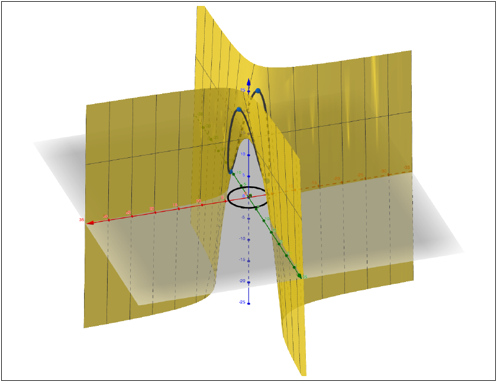
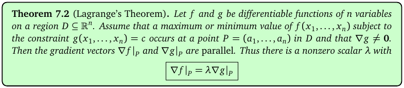
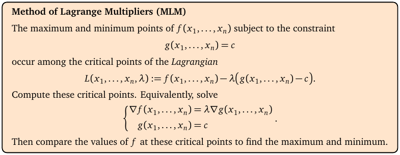
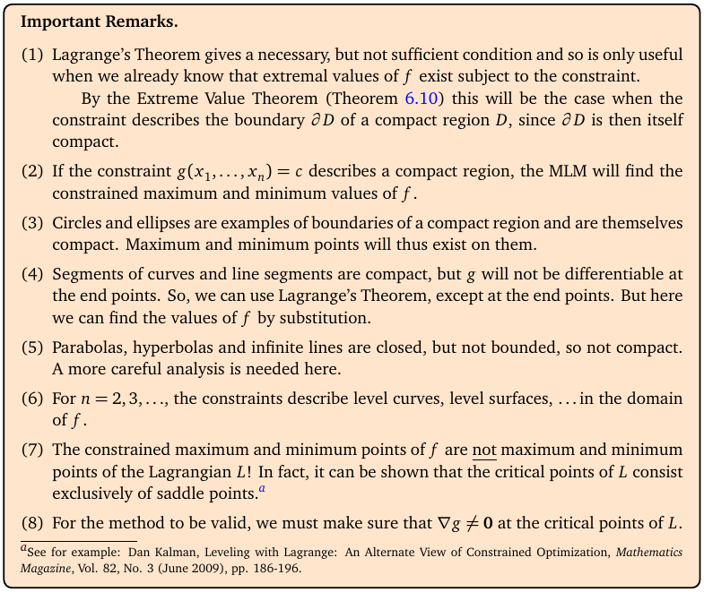
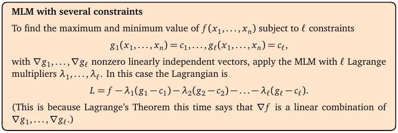
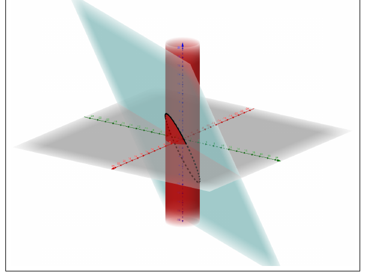
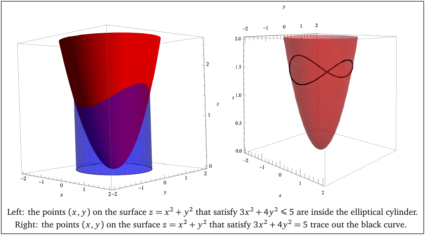
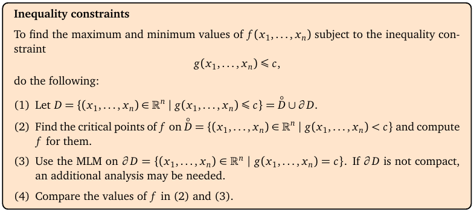

# Topic 14: Lagrange multipliers

Tutorial questions: Sheet 4 Q15 to Q20 · Sample exam Q6(a)

Notes pages: 87 to 101 (Chapter 7)

---

## The big idea

Find the biggest and smallest value of f(x, y, z) **while staying on** a constraint like x² + y² + z² = 2.

At the best points, the level surface of f just touches the constraint surface. Touching means their normal vectors are parallel:

$$\nabla f = \lambda \nabla g$$

λ ("lambda") is just a number, the **Lagrange multiplier**.

Solve that together with the constraint, list the points, plug them into f, compare.

With two constraints you add a second multiplier μ.

---

**How to use these notes:**
When you see 🧠, stop.
Answer it on paper first.
Then click to check.

---

## ⭐ Learn by heart from this topic

**One constraint** g = c:

$$\nabla f = \lambda \nabla g, \qquad g = c$$

**Two constraints** g₁ = c₁, g₂ = c₂:

$$\nabla f = \lambda \nabla g_1 + \mu \nabla g_2, \qquad g_1 = c_1, \quad g_2 = c_2$$

**Then:** plug every solution into f. Biggest = max, smallest = min.

**Memory hook:**
"Gradients parallel, stay on the constraint, then compare."

You don't need λ in the final answer. It's a helper.

---

## 1. Why the gradients are parallel

**How to read this diagram:**

- The yellow curved sheet is the graph of f(x, y) = xy + 14 (notes Ex 7.4).
- The constraint x² + y² = 18 is a circle on the floor. Above it, the black curve is the part of the surface you're allowed to be on.
- You want the highest and lowest points of that black curve.
- At those points, the level curve of f through the point just **touches** the circle. Touching curves have the same normal direction, so ∇f ∥ ∇g.

 

**How to read this box:**

If f has a max or min on the constraint g = c at a point P, and ∇g(P) ≠ 0, then ∇f(P) = λ∇g(P) for some number λ.

---

## 2. The method

**How to read this box:**

- Form the **Lagrangian** L = f − λ(g − c).
- Its critical points are the same as solving ∇f = λ∇g together with g = c.
- Compare the values of f at all those points.

 

**How to read this box (the bits that matter):**

- (1) Lagrange only gives **candidates**. It's useful when you already know a max and min exist, e.g. the constraint is **compact** (a circle, ellipse, sphere, ellipsoid). Then the biggest candidate is the max, the smallest is the min.
- (5) Lines, planes, parabolas, hyperbolas are not bounded: a max or min may not exist. Think before you claim one.
- (8) Check ∇g ≠ 0 at the points.

---

### 📐 Method: Lagrange, one constraint

| Step | Do this |
|---|---|
| 1 | Write f and g (constraint g = c). |
| 2 | Find ∇f and ∇g. |
| 3 | Write the equations: one per variable, $f_x = \lambda g_x$, $f_y = \lambda g_y$, ($f_z = \lambda g_z$), plus g = c. |
| 4 | Solve. Tricks below. Watch for "x = 0 **or** …" splits. |
| 5 | List every point (x, y, z). |
| 6 | Work out f at each. Biggest = max, smallest = min. |

**Solving tricks:**

| Trick | When |
|---|---|
| Factor, don't divide: x(y − λ) = 0 ⟹ x = 0 **or** y = λ | a variable multiplies everything |
| Get λ from two equations and set them equal: λ = y/2x = x/2y ⟹ x² = y² | λ is easy to isolate |
| Multiply equations by x, y, z so they look alike (e.g. 2x²yz = 2λx²) | products like x²yz |
| Express x, y, z in terms of λ, put into the constraint | linear equations |

 

### 🧠 Check
Max and min of f = xy + 14 on x² + y² = 18 (notes Ex 7.4)?

Answer

y = 2λx, x = 2λy. If x = 0 then y = 0, impossible on the circle. So λ = y/2x = x/2y ⟹ x² = y² = 9.

Points (±3, ±3). f(3, 3) = f(−3, −3) = 23, f(3, −3) = f(−3, 3) = 5.

**Max 23, min 5.**

---

## 3. Two constraints

**How to read this box:**

With ℓ constraints g₁ = c₁, …, g_ℓ = c_ℓ, use one multiplier each:

∇f = λ₁∇g₁ + … + λ_ℓ∇g_ℓ, plus all the constraints.

(The gradients ∇g₁, … must not be parallel to each other.)

 

**How to read this diagram:**

- Notes Ex 7.11: the cylinder x² + y² = 13 (red) and the plane 2x − y − z = 2 (blue).
- Points on **both** constraints = where they meet: an ellipse (black curve).
- An ellipse is compact, so f = 2y − z has a max and a min on it.

 

**How to read this diagram:**

- Notes Ex 7.12: f = x² + y² on the ellipse 3x² + 4y² = 5 (right: the black curve on the surface) and on the filled ellipse 3x² + 4y² ≤ 5 (left).
- On the curve: Lagrange. On the filled region: Topic 12 (inside + edge).

 

**How to read this box:**

For a constraint g ≤ c: check critical points of f strictly inside (g < c), use Lagrange on the edge (g = c), then compare. It's Topic 12's method with Lagrange doing the boundary.

---

### 📐 Method: Lagrange, two constraints

| Step | Do this |
|---|---|
| 1 | Write f, g₁, g₂. |
| 2 | Find ∇f, ∇g₁, ∇g₂ (write them as columns, it helps). |
| 3 | Equations: $f_x = \lambda (g_1)_x + \mu (g_2)_x$, same for y and z, plus g₁ = c₁ and g₂ = c₂. That's 5 equations, 5 unknowns. |
| 4 | If a constraint is simple (like z = 1), **substitute it** first. |
| 5 | Solve, list points, compare f. |

---

## 4. Worked example (Sample exam Q6 a)

Max and min of f = x²yz + 1 subject to z = 1 and x² + y² + z² = 10.

**Set up.** g₁ = z − 1, g₂ = x² + y² + z² − 10.

∇f = ⟨2xyz, x²z, x²y⟩, ∇g₁ = ⟨0, 0, 1⟩, ∇g₂ = ⟨2x, 2y, 2z⟩.

**Equations** (with z = 1 put in):

$$2xy = 2\mu x \quad (1)$$

$$x^2 = 2\mu y \quad (2)$$

$$x^2y = \lambda + 2\mu \quad (3)$$

$$x^2 + y^2 = 9 \quad (5)$$

(Equation (3) just tells you λ. You don't need it.)

**(1):** x(y − μ) = 0, so x = 0 or y = μ.

**Case I: x = 0.** (5) ⟹ y² = 9 ⟹ (0, 3, 1), (0, −3, 1).

**Case II: y = μ.** (2) ⟹ x² = 2y². (5) ⟹ 3y² = 9 ⟹ y = ±√3, x² = 6.

Points (±√6, √3, 1) and (±√6, −√3, 1).

**Compare:**

| Point | f = x²y + 1 |
|---|---|
| (0, ±3, 1) | 1 |
| (±√6, √3, 1) | 6√3 + 1 |
| (±√6, −√3, 1) | −6√3 + 1 |

**Max 1 + 6√3. Min 1 − 6√3.** Matches the official answer.

---

## 5. Word problems (Sheet 4 Q15)

Same steps. Turn the words into f (what you maximise) and g (what's fixed).

**Example (notes Ex 7.16):** rectangles with perimeter 16. Max area?

f = xy, g = 2(x + y) = 16. ∇f = λ∇g: y = 2λ, x = 2λ, so x = y = 4. Max area **16** (a square).

**Example (notes Ex 7.1):** a can with surface area 60 cm². f = V = πr²h, g = 2πr² + 2πrh = 60.

---

## Method table

| You're asked for | Use |
|---|---|
| max/min of f on one constraint | ∇f = λ∇g, g = c, compare (§2) |
| max/min on two constraints | ∇f = λ∇g₁ + μ∇g₂, both constraints, compare (§3) |
| max/min on a region with an edge (≤) | Topic 12: inside + Lagrange on the boundary (notes §7.4) |
| a word problem | f = thing to optimise, g = thing that's fixed (§5) |

---

Next: [End-of-topic test](../questions/14-lagrange.md)
