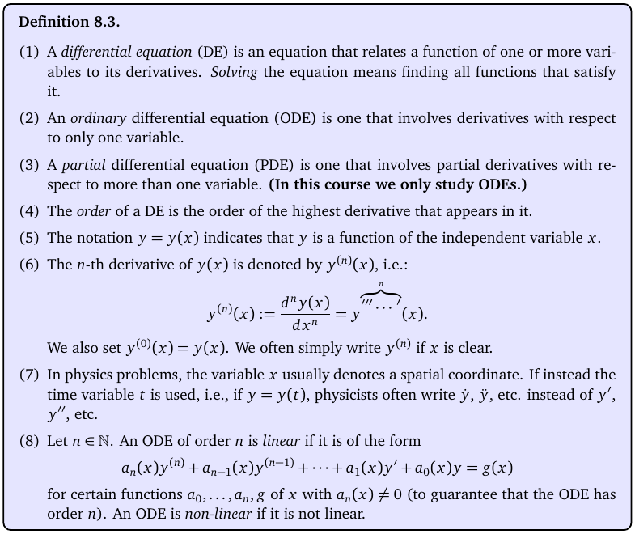
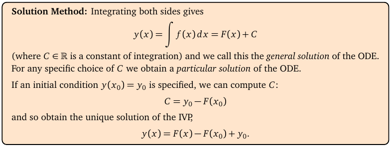
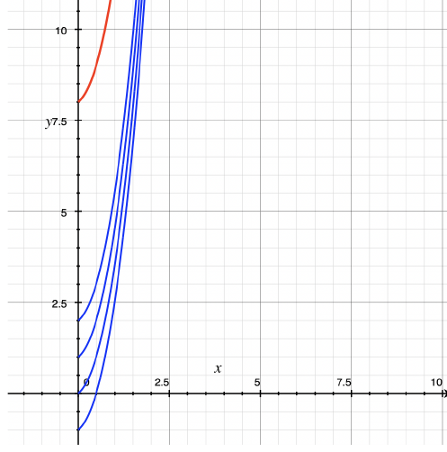
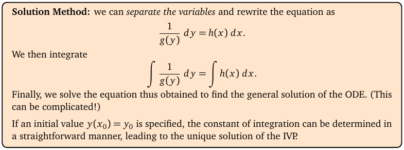
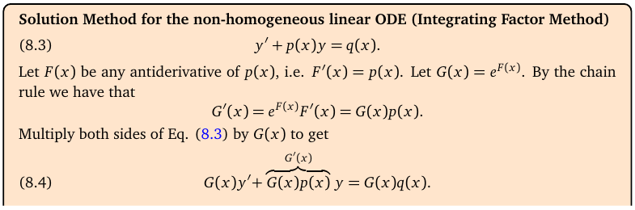
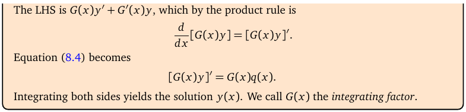
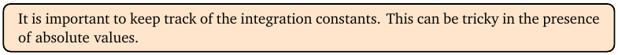

# Topic 15: First order ODEs (separable and linear)

Tutorial questions: Sheet 5 Q1, Q2

Notes pages: 103 to 113 (§8.1 to §8.3)

---

## The big idea

A differential equation (DE) links an unknown function y(x) with its derivatives.

Solving it means finding y.

For **first order** equations (only y′, no y″) you need to spot one of two types:

1. **Separable:** y′ = (something in x) × (something in y). Get all the y's on one side, x's on the other, integrate.
2. **Linear:** y′ + p(x)y = q(x). Multiply by an **integrating factor** so the left side becomes one derivative, then integrate.

An **initial condition** like y(0) = 1 fixes the constant C.

---

**How to use these notes:**
When you see 🧠, stop.
Answer it on paper first.
Then click to check.

---

## ⭐ Learn by heart from this topic

**Separable** $\frac{dy}{dx} = h(x)g(y)$:

$$\int \frac{1}{g(y)}\,dy = \int h(x)\,dx$$

**Linear** $y' + p(x)\,y = q(x)$:

$$G(x) = e^{\int p(x)\,dx}, \qquad (G\,y)' = G\,q, \qquad y = \frac{1}{G}\left(\int G\,q\,dx + C\right)$$

**Memory hook:**
Separable: "y's left, x's right, integrate both, add one C."
Linear: "make the coefficient of y′ equal 1, find G, multiply through, the left side is (Gy)′."

---

## 1. Words you need

**How to read this box (the useful lines):**

| Word | Means | Example |
|---|---|---|
| ODE | ordinary DE: one independent variable | y′ = 3x + 2y |
| order | highest derivative in it | y″ + y = 0 is order 2 |
| linear | y and its derivatives appear only to the power 1, multiplied by functions of x | y′ + x²y = eˣ ✓, y′ + y² = 1 ✗ |
| homogeneous | the right side (the part without y) is 0 | y″ + 4y = 0 |
| general solution | contains arbitrary constants C | y = Ce^(2x) |
| IVP | the DE plus initial condition(s) | y′ = ty, y(0) = 1 |

 

### 🧠 Check
Is x²y′ + xy = eˣ linear? Order?

Answer

Linear (y and y′ only to power 1, coefficients are functions of x). Order 1.

---

## 2. The simplest case: y′ = f(x)

**How to read this box:**

If the right side has no y, just integrate: y = ∫f(x) dx = F(x) + C.

An initial condition y(x₀) = y₀ gives C = y₀ − F(x₀).

 

**How to read this diagram:**

- Notes Ex 8.10: y′ = eˣ + 5x − √x.
- Each blue curve is the general solution with a different C. They're the same shape, shifted up and down.
- The red curve is the one that also passes through the initial point (y(0) = 8). Only one curve does.

---

## 3. Separable equations

**How to read this box:**

- Separable means dy/dx = h(x)·g(y).
- Divide by g(y), "multiply by dx": (1/g(y)) dy = h(x) dx.
- Integrate both sides. Solve for y if you can.
- Use the initial condition to find the constant.

---

### 📐 Method: separable

| Step | Do this |
|---|---|
| 1 | Check you can write the right side as (x-stuff) × (y-stuff). Factor if needed: 1 + x² + y + x²y = (1 + x²)(1 + y). |
| 2 | Separate: y's and dy on the left, x's and dx on the right. |
| 3 | Integrate both. Put **one** constant C on the right. |
| 4 | Solve for y. (ln\|1 + y\| = … ⟹ 1 + y = Ae^(…), where A = ±e^C.) |
| 5 | Initial condition → C. |

**Use it when:**
You can split the right side into a product.

⚠️ When you divide by g(y), you might lose solutions where g(y) = 0 (like y = −1 in y′ = (1 + x)(1 + y)). Writing the answer with A instead of e^C usually brings them back (A = 0).

 

### 🧠 Check
Solve y′ = ty, y(0) = 1.

Answer

dy/y = t dt ⟹ ln|y| = t²/2 + C ⟹ y = Ae^(t²/2).

y(0) = A = 1. So **y = e^(t²/2)**. (Sheet 5 Q1a.)

---

## 4. Linear equations

**How to read this box:**

- Standard form: y′ + p(x)y = q(x). (Coefficient of y′ must be 1.)
- F(x) = an antiderivative of p(x). G(x) = e^F(x) is the **integrating factor**.
- G′ = G·p (chain rule).
- Multiply the DE by G: Gy′ + Gpy = Gq.

 

**How to read this box:**

- The left side Gy′ + G′y is the product rule for (Gy)′.
- So the equation is just (Gy)′ = Gq.
- Integrate both sides and divide by G.

---

### 📐 Method: linear (integrating factor)

| Step | Do this |
|---|---|
| 1 | Divide so it reads y′ + p(x)y = q(x). Write down p and q. |
| 2 | ∫p dx (no constant needed here). |
| 3 | G = e^(∫p dx). Simplify: e^(2 ln x) = x². |
| 4 | Write (Gy)′ = Gq. |
| 5 | Integrate: Gy = ∫Gq dx + C. **Don't forget C.** |
| 6 | Divide by G. |
| 7 | Initial condition → C. |

**Use it when:**
y and y′ appear only to power 1, but it isn't separable (or separating is messy).

 

### 🧠 Check
Solve y′ − 3x²y = x² (notes Ex 8.23).

Answer

p = −3x², ∫p = −x³, G = e^(−x³).

(e^(−x³)y)′ = x²e^(−x³) ⟹ e^(−x³)y = −(1/3)e^(−x³) + C.

**y = −1/3 + Ce^(x³)**.

(It's also separable: y′ = x²(1 + 3y). Same answer.)

---

## 5. Keeping track of constants

**How to read this box:**

Constants get renamed as you go (e^C becomes A, 2C becomes C…). That's fine, as long as you keep **one** arbitrary constant in a first-order general solution.

Put it in **at the moment you integrate**, not at the end. "Gy = ∫Gq dx" then "+ C" after dividing by G is wrong.

---

## 6. Worked example (Sheet 5 Q2 e)

$$y' + \frac{2y}{x} = \frac{1}{x^2}$$

**Step 1:** p = 2/x, q = 1/x².

**Step 2:** ∫p = 2 ln x.

**Step 3:** G = e^(2 ln x) = x².

**Step 4:** (x²y)′ = x² · 1/x² = 1.

**Step 5:** x²y = x + C.

**Step 6:**

$$y = \frac{x + C}{x^2} = \frac1x + \frac{C}{x^2}$$

**Check:** y′ = −1/x² − 2C/x³. Then y′ + 2y/x = −1/x² − 2C/x³ + 2/x² + 2C/x³ = 1/x² ✓.

---

## Method table

| You're asked for | Use |
|---|---|
| y′ = f(x) | integrate (§2) |
| y′ = h(x)g(y) | separate and integrate (§3) |
| y′ + p(x)y = q(x) | integrating factor G = e^(∫p) (§4) |
| an IVP | general solution first, then the condition gives C (§2) |
| check your answer | put y back into the DE |

---

Next: [End-of-topic test](../questions/15-first-order-odes.md)
