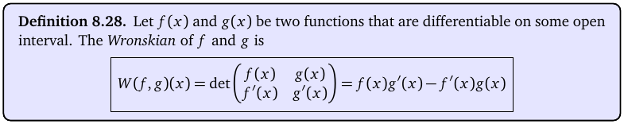
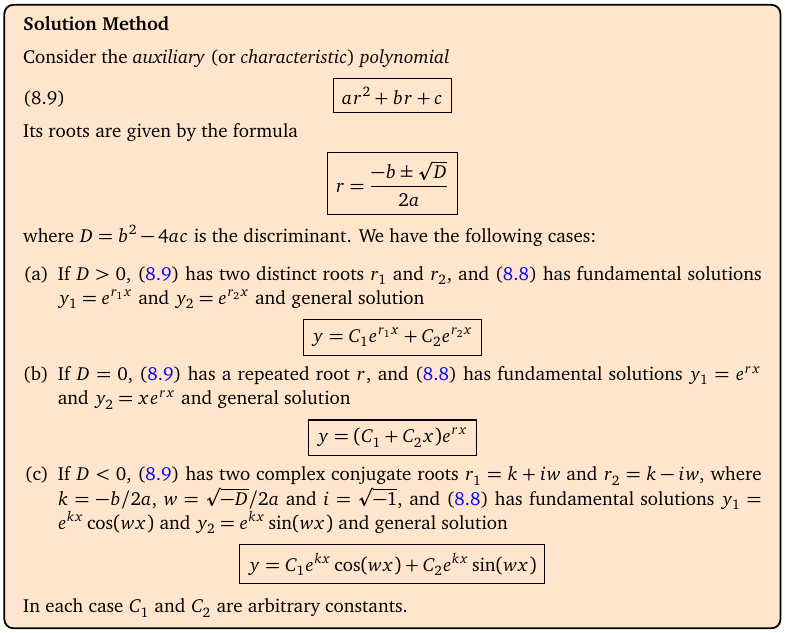
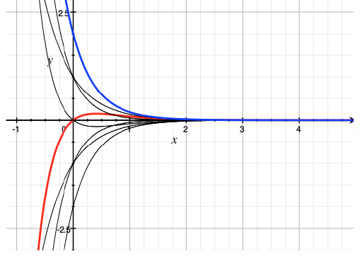

# Topic 16: Second order homogeneous ODEs (the auxiliary equation)

Tutorial questions: Sheet 5 Q3, Q5(a)

Notes pages: 113 to 118 (§8.4.1, §8.4.2.1)

---

## The big idea

For ay″ + by′ + cy = 0 with constant a, b, c, guess y = e^(rx).

Plugging it in turns the DE into an ordinary quadratic, the **auxiliary equation**:

$$ar^2 + br + c = 0$$

Its roots tell you the answer straight away. Three cases: two real roots, one double root, complex roots.

This is the first half of every second-order question, including exam Q6(b).

---

**How to use these notes:**
When you see 🧠, stop.
Answer it on paper first.
Then click to check.

---

## ⭐ Learn by heart from this topic

For ay″ + by′ + cy = 0, solve ar² + br + c = 0, with D = b² − 4ac:

| Roots | General solution |
|---|---|
| D > 0: two real r₁ ≠ r₂ | $y = C_1e^{r_1x} + C_2e^{r_2x}$ |
| D = 0: double root r | $y = (C_1 + C_2x)e^{rx}$ |
| D < 0: r = k ± iω | $y = e^{kx}(C_1\cos\omega x + C_2\sin\omega x)$ |

where k = −b/(2a), ω = √(−D)/(2a).

**Memory hook:**
"Distinct → two exponentials. Double → stick an x on the second. Complex → e^(real part) times cos and sin of the imaginary part."

---

## 1. The set-up

A second-order linear ODE:

$$a_2(x)y'' + a_1(x)y' + a_0(x)y = f(x)$$

- **Homogeneous** if f(x) = 0.
- Its general solution is $y_h = C_1y_1 + C_2y_2$, where y₁, y₂ are two "independent" solutions (neither is a multiple of the other).
- For a non-homogeneous one, $y = y_h + y_p$ (Topic 17).
- Two constants, so an IVP needs **two** conditions: y(x₀) and y′(x₀).

 

**How to read this box:**

The Wronskian W(f, g) = fg′ − f′g. If it isn't 0, the two solutions are independent. You'll rarely need to compute it. Just know: e^(r₁x), e^(r₂x) with r₁ ≠ r₂ are independent; so are e^(rx), xe^(rx); so are e^(kx)cos ωx, e^(kx)sin ωx.

---

## 2. The auxiliary equation

**How to read this box:**

- Write the auxiliary polynomial ar² + br + c (y″ → r², y′ → r, y → 1).
- Find its roots with the quadratic formula r = (−b ± √D)/(2a).
- (a) D > 0: two different real roots → y = C₁e^(r₁x) + C₂e^(r₂x).
- (b) D = 0: one repeated root → y = (C₁ + C₂x)e^(rx).
- (c) D < 0: complex roots k ± iω → y = C₁e^(kx)cos(ωx) + C₂e^(kx)sin(ωx).

 

**Why e^(rx)?** y = e^(rx) gives y′ = re^(rx), y″ = r²e^(rx). So ay″ + by′ + cy = e^(rx)(ar² + br + c). Since e^(rx) ≠ 0, it's a solution exactly when ar² + br + c = 0.

**Why cos and sin?** Euler: e^(iθ) = cos θ + i sin θ. The complex exponentials e^((k ± iω)x) combine into the real solutions e^(kx)cos ωx and e^(kx)sin ωx.

---

### 📐 Method: homogeneous constant-coefficient ODE

| Step | Do this |
|---|---|
| 1 | Write ar² + br + c = 0. |
| 2 | Factor, or use the quadratic formula. Note D = b² − 4ac. |
| 3 | Pick the case from the table. Write y with C₁, C₂. |
| 4 | IVP? Find y′, plug in both conditions, solve the 2 × 2 system for C₁, C₂. |

**Use it when:**
"Find the general solution of y″ + by′ + cy = 0", or as step 1 of any non-homogeneous problem.

⚠️ **Missing y-term:** y″ − 9y′ = 0 gives r² − 9r = r(r − 9) = 0, so r = 0 and r = 9. e^(0x) = 1, so y = C₁ + C₂e^(9x).

⚠️ **Missing y′-term:** y″ + 4y = 0 gives r² = −4, r = ±2i (k = 0, ω = 2). y = C₁cos 2x + C₂sin 2x.

 

### 🧠 Check
Solve y″ + 5y′ + 6y = 0 (notes Ex 8.32).

Answer

r² + 5r + 6 = (r + 2)(r + 3) = 0 ⟹ r = −2, −3.

**y = C₁e^(−2x) + C₂e^(−3x)**.

 

### 🧠 Check
Solve y″ − 4y′ + 13y = 0 (notes Ex 8.35).

Answer

r = (4 ± √(16 − 52))/2 = (4 ± 6i)/2 = 2 ± 3i. So k = 2, ω = 3.

**y = e^(2x)(C₁cos 3x + C₂sin 3x)**.

---

## 3. What the solutions look like

**How to read this diagram:**

- Each curve is y = C₁e^(−2x) + C₂e^(−3x) for different C₁, C₂.
- Both roots are negative, so every solution dies away to 0 as x grows (all curves flatten onto the x-axis on the right).
- Blue: C₁ = C₂ = 1. Red: C₁ = 1, C₂ = −1.
- Two conditions (a starting height and a starting slope) pick out exactly one curve.

---

## 4. Worked example (Sheet 5 Q5 a)

y″ − 16y = 0, y(0) = 1, y′(0) = 20.

**Step 1:** r² − 16 = 0.

**Step 2:** r = ±4.

**Step 3:** y = C₁e^(4x) + C₂e^(−4x).

**Step 4:** y′ = 4C₁e^(4x) − 4C₂e^(−4x).

- y(0) = C₁ + C₂ = 1
- y′(0) = 4C₁ − 4C₂ = 20 ⟹ C₁ − C₂ = 5

Add: 2C₁ = 6, C₁ = 3, C₂ = −2.

$$y = 3e^{4x} - 2e^{-4x}$$

---

## Method table

| You're asked for | Use |
|---|---|
| general solution of ay″ + by′ + cy = 0 | auxiliary equation + the 3-case table (§2) |
| an IVP | general solution, then y(x₀) and y′(x₀) → C₁, C₂ (§4) |
| roots r = 0 | e^(0x) = 1 gives a constant term (§2) |

---

Next: [End-of-topic test](../questions/16-second-order-homogeneous.md)
