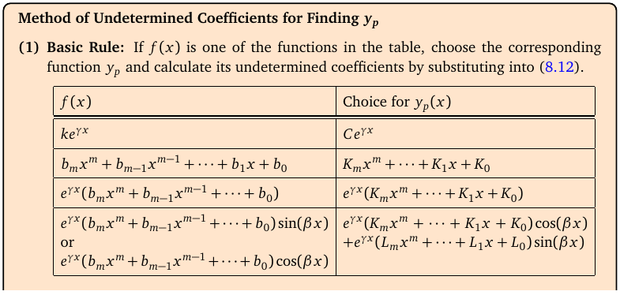
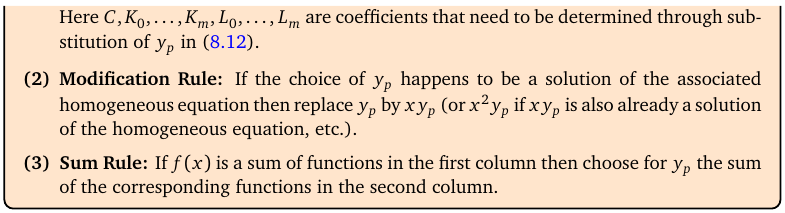

# Topic 17: Non-homogeneous ODEs: undetermined coefficients

Tutorial questions: Sheet 5 Q4, Q5(b), Q5(c) · Sample exam Q6(b)

Notes pages: 118 to 121 (§8.4.2.2)

---

## The big idea

Now the right side isn't 0: ay″ + by′ + cy = f(x).

The answer has two parts:

$$y = y_h + y_p$$

- $y_h$: the general solution of the homogeneous version (Topic 16). Has the constants C₁, C₂.
- $y_p$: **any one** solution of the full equation. No constants.

To find $y_p$, make an educated **guess** that looks like f(x), with unknown coefficients A, B, C…. Plug it in and match terms.

---

**How to use these notes:**
When you see 🧠, stop.
Answer it on paper first.
Then click to check.

---

## ⭐ Learn by heart from this topic

**The guess table:**

| f(x) | Guess for $y_p$ |
|---|---|
| $ke^{\gamma x}$ | $Ce^{\gamma x}$ |
| polynomial of degree m | $K_mx^m + \cdots + K_1x + K_0$ (**all** powers down to the constant) |
| polynomial × $e^{\gamma x}$ | (same-degree polynomial) × $e^{\gamma x}$ |
| $\cos\beta x$ or $\sin\beta x$ (× poly × $e^{\gamma x}$) | $e^{\gamma x}\left[(\text{poly})\cos\beta x + (\text{poly})\sin\beta x\right]$ (**both** cos and sin) |

**Sum rule:** f is a sum → add the guesses.

**Modification rule:** if any term of your guess already solves the homogeneous equation, multiply that part by x (or x² if needed).

**Memory hook:**
"Guess the same shape. Include all powers and both cos and sin. Clash with y_h? Multiply by x."

---

## 1. The method in the notes

**How to read this box:**

- (1) **Basic rule:** find f(x) in the left column, take the matching guess on the right.
- Left: what's on the right side of your ODE. Right: what to try for y_p.
- Notice: a polynomial of degree m needs a **full** polynomial of degree m as the guess (x² needs Ax² + Bx + C, not just Ax²).
- cos or sin alone still needs **both** cos and sin in the guess.

 

**How to read this box:**

- (2) **Modification rule:** if your guess happens to solve the homogeneous equation, multiply it by x (or x² if xy_p also does).
- (3) **Sum rule:** if f is a sum of table entries, the guess is the sum of their guesses.

---

### 📐 Method: undetermined coefficients

| Step | Do this |
|---|---|
| 1 | Solve the homogeneous equation: auxiliary equation → $y_h$ (Topic 16). |
| 2 | Write the guess for $y_p$ from the table (sum rule for sums). |
| 3 | **Compare with $y_h$.** Any term of the guess that appears in $y_h$? Multiply that piece by x. Still clashes? x². |
| 4 | Find $y_p'$ and $y_p''$. |
| 5 | Substitute into the ODE. Collect like terms (x², x, 1, eˣ, cos, sin …). |
| 6 | Match coefficients on both sides. Solve for A, B, C, …. |
| 7 | $y = y_h + y_p$. |
| 8 | IVP? Use the conditions on the **full** y (not just $y_h$) to find C₁, C₂. |

**Use it when:**
Constant coefficients, and f(x) is made of exponentials, polynomials, sin and cos.

 

### 🧠 Check
What's the guess for y_p? (Don't solve.)

(a) y″ − y = 3x²  (b) y″ + 4y = cos t  (c) y″ − 3y′ + 2y = eˣ

Answer

(a) Ax² + Bx + C.

(b) D cos t + E sin t. (cos t is **not** in y_h = c₁cos 2t + c₂sin 2t, so no modification.)

(c) y_h = C₁eˣ + C₂e^(2x) already contains eˣ. So **modify**: Cxeˣ. (Notes Ex 8.38.)

---

## 2. A full example from the notes (Ex 8.37)

y″ − 6y′ + 8y = 2x² − 1.

**Step 1.** r² − 6r + 8 = (r − 2)(r − 4). y_h = C₁e^(2x) + C₂e^(4x).

**Step 2.** Degree-2 polynomial: y_p = Ax² + Bx + C. No clash.

**Step 4.** y_p′ = 2Ax + B, y_p″ = 2A.

**Step 5.** 2A − 6(2Ax + B) + 8(Ax² + Bx + C) = 2x² − 1:

8Ax² + (−12A + 8B)x + (2A − 6B + 8C) = 2x² − 1.

**Step 6.** 8A = 2, −12A + 8B = 0, 2A − 6B + 8C = −1 ⟹ A = 1/4, B = 3/8, C = 3/32.

**Step 7.**

$$y = C_1e^{2x} + C_2e^{4x} + \frac14x^2 + \frac38x + \frac{3}{32}$$

---

## 3. The modification rule in action

**y″ − 2y′ = 6** (notes Ex 8.39): r(r − 2) = 0, so y_h = C₁ + C₂e^(2x).

Guess for 6: a constant A. But constants are already in y_h (C₁). Modify: **y_p = Ax**.

y_p′ = A, y_p″ = 0: 0 − 2A = 6, A = −3. So y = C₁ + C₂e^(2x) − 3x.

 

**Shortcut for f = (polynomial) × e^(γx):** put y = u·e^(γx). Then y″ + by′ + cy = e^(γx)[u″ + (2γ + b)u′ + (γ² + bγ + c)u]. You only solve for the polynomial u. (Optional, but quick: see Sheet 5 Q4f.)

 

### 🧠 Check
y″ − 4y′ + 3y = 4e^(3x). What's the guess?

Answer

y_h = C₁eˣ + C₂e^(3x) contains e^(3x). So y_p = **Axe^(3x)**.

---

## 4. Worked example (Sample exam Q6 b)

y″ + 4y = t² + cos t.

**Step 1.** r² + 4 = 0 ⟹ r = ±2i.

$$y_h = c_1\cos 2t + c_2\sin 2t$$

**Step 2.** Sum rule: t² → At² + Bt + C. cos t → D cos t + E sin t.

$$y_p = At^2 + Bt + C + D\cos t + E\sin t$$

**Step 3.** No clash (cos t ≠ cos 2t).

**Step 4.** y_p′ = 2At + B − D sin t + E cos t, y_p″ = 2A − D cos t − E sin t.

**Step 5.** y_p″ + 4y_p = 4At² + 4Bt + (2A + 4C) + 3D cos t + 3E sin t.

**Step 6.** Match with t² + cos t:

| Term | Equation | Gives |
|---|---|---|
| t² | 4A = 1 | A = 1/4 |
| t | 4B = 0 | B = 0 |
| 1 | 2A + 4C = 0 | C = −1/8 |
| cos t | 3D = 1 | D = 1/3 |
| sin t | 3E = 0 | E = 0 |

**Step 7.**

$$y = c_1\cos 2t + c_2\sin 2t + \frac14t^2 - \frac18 + \frac13\cos t$$

Matches the official answer.

---

## Method table

| You're asked for | Use |
|---|---|
| general solution of ay″ + by′ + cy = f | y = y_h + y_p (§1) |
| the guess for y_p | the table + sum rule (§1) |
| guess clashes with y_h | multiply by x (§3) |
| an IVP | full y = y_h + y_p first, then the conditions (§1) |

---

Next: [End-of-topic test](../questions/17-undetermined-coefficients.md)
