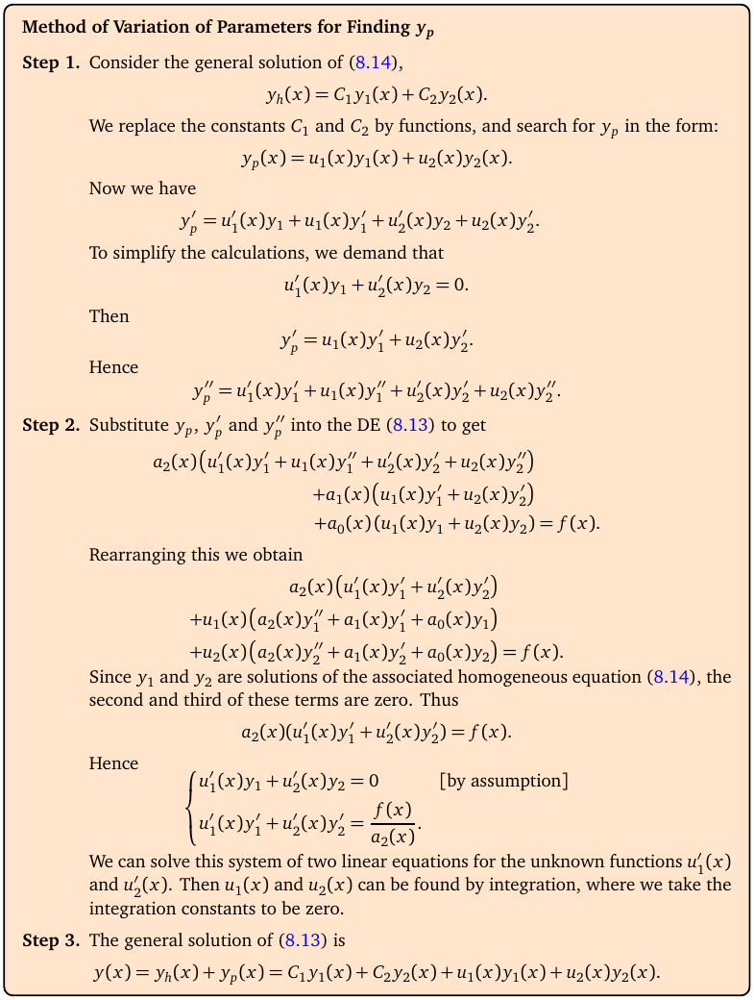

# Topic 18: Variation of parameters

Tutorial questions: Sheet 5 Q6

Notes pages: 121 to 124 (§8.4.3)

---

## The big idea

Undetermined coefficients (Topic 17) only works when f(x) is a nice exponential, polynomial, sin or cos.

**Variation of parameters** always works (if you can do the integrals).

Take $y_h = C_1y_1 + C_2y_2$ and replace the constants by functions:

$$y_p = u_1(x)y_1 + u_2(x)y_2$$

Two simple equations give u₁′ and u₂′. Integrate them. Done.

Sheet 5 Q6 says "using the method of variation of parameters", so you must show this method even when guessing would be quicker.

---

**How to use these notes:**
When you see 🧠, stop.
Answer it on paper first.
Then click to check.

---

## ⭐ Learn by heart from this topic

For $a_2y'' + a_1y' + a_0y = f(x)$ with homogeneous solutions y₁, y₂:

$$u_1'y_1 + u_2'y_2 = 0$$

$$u_1'y_1' + u_2'y_2' = \frac{f(x)}{a_2}$$

Solve those for u₁′, u₂′ (Cramer's rule gives the shortcut):

$$W = y_1y_2' - y_1'y_2, \qquad u_1' = -\frac{y_2\,g}{W}, \qquad u_2' = \frac{y_1\,g}{W}, \qquad g = \frac{f}{a_2}$$

Then integrate (no constants needed) and $y_p = u_1y_1 + u_2y_2$.

**Memory hook:**
"Top equation = 0. Bottom equation = f over the leading coefficient. Derivatives on the y's only in the bottom one."

---

## 1. The method in the notes

**How to read this box:**

- **Step 1.** Start from y_h = C₁y₁ + C₂y₂. Replace C₁, C₂ by unknown functions u₁(x), u₂(x).
- To keep things simple we **demand** u₁′y₁ + u₂′y₂ = 0. (We're allowed one extra condition.)
- Then y_p′ = u₁y₁′ + u₂y₂′ (no u′ terms), and y_p″ = u₁′y₁′ + u₂′y₂′ + u₁y₁″ + u₂y₂″.
- **Step 2.** Put y_p into the ODE. Because y₁, y₂ solve the homogeneous equation, almost everything cancels, leaving a₂(u₁′y₁′ + u₂′y₂′) = f(x).
- So you get the 2 × 2 system for u₁′, u₂′ at the bottom of the box. Solve it, integrate (constants can be 0).
- **Step 3.** y = y_h + y_p.

---

### 📐 Method: variation of parameters

| Step | Do this |
|---|---|
| 1 | Find y₁, y₂ from the auxiliary equation (Topic 16). |
| 2 | Write the system: u₁′y₁ + u₂′y₂ = 0 and u₁′y₁′ + u₂′y₂′ = f/a₂. |
| 3 | Solve it: W = y₁y₂′ − y₁′y₂, u₁′ = −y₂g/W, u₂′ = y₁g/W. Simplify the exponentials. |
| 4 | Integrate u₁′ and u₂′ (integration by parts for x·e^(…)). No constants. |
| 5 | y_p = u₁y₁ + u₂y₂. Simplify (exponentials usually cancel). |
| 6 | y = y_h + y_p. |

**Use it when:**
The question says "variation of parameters", or f(x) is not in the Topic 17 table (like 1/x, tan x).

⚠️ **Leading coefficient trap:** in 2y″ + y′ − y = 4x the right side of the second equation is 4x/2 = **2x**, not 4x.

**Integration by parts you'll need:**

$$\int xe^{kx}\,dx = \frac{x}{k}e^{kx} - \frac{1}{k^2}e^{kx}$$

 

### 🧠 Check
For y″ − 3y′ + 2y = 4x, write down y₁, y₂ and the system for u₁′, u₂′ (notes Ex 8.41).

Answer

r² − 3r + 2 = (r − 1)(r − 2): y₁ = eˣ, y₂ = e^(2x).

u₁′eˣ + u₂′e^(2x) = 0

u₁′eˣ + 2u₂′e^(2x) = 4x

(Subtract: u₂′e^(2x) = 4x. Then u₁′ = −4xe^(−x).)

---

## 2. Finishing notes Ex 8.41

u₂′ = 4xe^(−2x) ⟹ u₂ = −(2x + 1)e^(−2x).

u₁′ = −4xe^(−x) ⟹ u₁ = 4(x + 1)e^(−x).

y_p = u₁eˣ + u₂e^(2x) = 4(x + 1) − (2x + 1) = **2x + 3**.

y = C₁eˣ + C₂e^(2x) + 2x + 3.

(Undetermined coefficients with guess Ax + B gives the same y_p. Good check.)

---

## 3. Worked example (Sheet 5 Q6 a)

y″ − 9y′ + 20y = 3.

**Step 1.** r² − 9r + 20 = (r − 4)(r − 5). y₁ = e^(4x), y₂ = e^(5x).

**Step 2–3.** a₂ = 1, g = 3. W = e^(4x)·5e^(5x) − 4e^(4x)·e^(5x) = e^(9x).

$$u_1' = -\frac{e^{5x}\cdot3}{e^{9x}} = -3e^{-4x}, \qquad u_2' = \frac{e^{4x}\cdot3}{e^{9x}} = 3e^{-5x}$$

**Step 4.** u₁ = (3/4)e^(−4x), u₂ = −(3/5)e^(−5x).

**Step 5.** y_p = 3/4 − 3/5 = **3/20**.

**Step 6.**

$$y = C_1e^{4x} + C_2e^{5x} + \frac{3}{20}$$

Check: y_p = 3/20 constant, so 20 · 3/20 = 3 ✓.

---

## Method table

| You're asked for | Use |
|---|---|
| y_p "by variation of parameters" | the u₁′, u₂′ system (§1) |
| f(x) not in the guess table | variation of parameters (§1) |
| check your y_p | plug into the ODE, or redo with undetermined coefficients |

---

Next: [End-of-topic test](../questions/18-variation-of-parameters.md)
