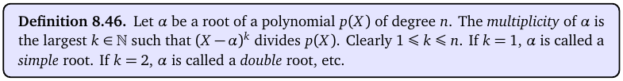
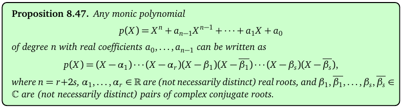
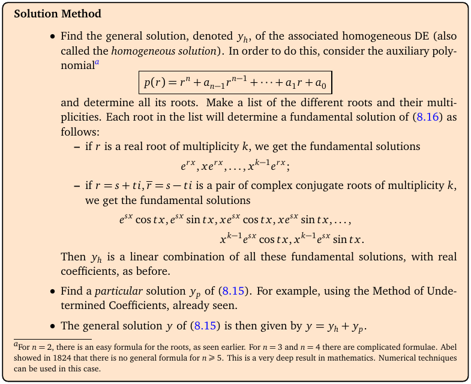

# Topic 19: Higher order linear ODEs (constant coefficients)

Tutorial questions: Sheet 5 Q7, Q8

Notes pages: 124 to 130 (§8.5, §8.6)

---

## The big idea

Third and fourth order equations work **exactly** like second order ones (Topics 16–18).

- Auxiliary polynomial: y⁽ⁿ⁾ → rⁿ.
- Find all its roots, **with multiplicities**.
- Each root gives as many solutions as its multiplicity: e^(rx), xe^(rx), x²e^(rx), ….
- Non-homogeneous: same guess table; the modification rule now multiplies by x^k, where k is the multiplicity of the clashing root.

The only new skill is factoring a cubic or a quartic.

---

**How to use these notes:**
When you see 🧠, stop.
Answer it on paper first.
Then click to check.

---

## ⭐ Learn by heart from this topic

| Root of the auxiliary polynomial | Contributes to y_h |
|---|---|
| real r, multiplicity k | $e^{rx},\ xe^{rx},\ \ldots,\ x^{k-1}e^{rx}$ |
| complex k ± iω, multiplicity m | $e^{kx}\cos\omega x,\ e^{kx}\sin\omega x$, each also times $x, \ldots, x^{m-1}$ |

**Total count:** an n-th order ODE has n fundamental solutions and n constants.

**Factoring a cubic:** try divisors of the constant term (±1, ±2, …). If p(a) = 0, divide by (r − a).

**Modification rule:** if f's exponent (or e^(iβx)) is a root of multiplicity k, multiply the guess by x^k.

**Memory hook:**
"Repeat a root → add another power of x."

---

## 1. Facts about polynomials

**How to read this box:**

The multiplicity of a root α is how many times (X − α) divides the polynomial. (r + 2)³ has the root −2 with multiplicity 3.

 

**How to read this box:**

Any polynomial with real coefficients splits into real roots and complex conjugate pairs α ± iβ (each pair counted with multiplicity). A cubic always has at least one real root.

 

**Tricks for factoring:**

| Pattern | Factor |
|---|---|
| group in pairs | r³ + 4r² − r − 4 = r²(r + 4) − (r + 4) = (r + 4)(r² − 1) |
| try r = a with a dividing the constant | r³ + 4r² − 3r − 18: r = 2 gives 0, so (r − 2)(r² + 6r + 9) |
| binomial cube | r³ + 6r² + 12r + 8 = (r + 2)³ |
| quadratic in r² | r⁴ + 8r² + 16 = (r² + 4)² |
| difference of squares | r⁴ − 16 = (r² − 4)(r² + 4) |

 

### 🧠 Check
Factor r³ − 7r + 6 (notes Ex 8.50).

Answer

r = 1: 1 − 7 + 6 = 0. Divide: r³ − 7r + 6 = (r − 1)(r² + r − 6) = (r − 1)(r − 2)(r + 3).

Roots 1, 2, −3.

---

## 2. The method

**How to read this box:**

- Auxiliary polynomial p(r) = rⁿ + aₙ₋₁rⁿ⁻¹ + … + a₀. Find all roots with multiplicities.
- Real root r of multiplicity k gives e^(rx), xe^(rx), …, x^(k−1)e^(rx).
- A complex pair s ± ti of multiplicity k gives e^(sx)cos tx, e^(sx)sin tx, times 1, x, …, x^(k−1).
- y_h = any combination of these. Then y_p by undetermined coefficients, and y = y_h + y_p.

---

### 📐 Method: n-th order constant-coefficient ODE

| Step | Do this |
|---|---|
| 1 | Write p(r). Factor it fully (§1). |
| 2 | List roots with multiplicities. |
| 3 | Write y_h with n constants (table above). |
| 4 | Non-homogeneous? Guess y_p (Topic 17 table, sum rule). Multiply each piece by x^k if it clashes with a root of multiplicity k. |
| 5 | Substitute, match coefficients. |
| 6 | IVP: n conditions → n equations for the constants. Look for easy ones first (often several constants are 0). |

 

### 🧠 Check
Write y_h for y⁽⁴⁾ + 8y″ + 16y = 0.

Answer

(r² + 4)² = 0: ±2i, each multiplicity 2.

**y_h = (C₁ + C₂x)cos 2x + (C₃ + C₄x)sin 2x**.

---

## 3. A useful shortcut for y_p when f is in y_h

If f = (something that solves the homogeneous equation), the guess picks up x or x².

**Example (Sheet 5 Q7b):** y⁽⁴⁾ − 16y = 30 sin 2t. Roots ±2, ±2i. sin 2t clashes with ±2i (multiplicity 1), so guess y_p = t(A cos 2t + B sin 2t).

Substituting (long but mechanical) gives A = 15/16, B = 0: y_p = (15/16)t cos 2t.

Tip: for y = t·g with g a homogeneous solution, (D⁴ − 16)(tg) = 4g‴. Here 4g‴ = 32A sin 2t − 32B cos 2t = 30 sin 2t.

---

## 4. Worked example (Sheet 5 Q8 e)

y‴ + 4y″ − 7y′ − 10y = 100x² − 64e^(3x), y(0) = −20, y′(0) = −29/5, y″(0) = 19/5.

**Step 1.** p(r) = r³ + 4r² − 7r − 10. r = 2: 8 + 16 − 14 − 10 = 0. So p = (r − 2)(r² + 6r + 5) = (r − 2)(r + 1)(r + 5).

**Step 3.** y_h = C₁e^(2x) + C₂e^(−x) + C₃e^(−5x).

**Step 4.** Guess y_p = Ax² + Bx + C + De^(3x) (3 isn't a root, no clash).

**Step 5.** Polynomial part: 4(2A) − 7(2Ax + B) − 10(Ax² + Bx + C) = 100x².

x²: −10A = 100 ⟹ A = −10. x: −14A − 10B = 0 ⟹ B = 14. 1: 8A − 7B − 10C = 0 ⟹ C = −89/5.

Exponential part: D·p(3) = D(27 + 36 − 21 − 10) = 32D = −64 ⟹ D = −2.

**Step 6.** The three conditions give C₁ = −2, C₂ = −1/5, C₃ = 2.

$$y = -2e^{2x} - \frac15e^{-x} + 2e^{-5x} - 10x^2 + 14x - \frac{89}{5} - 2e^{3x}$$

Check y(0): −2 − 1/5 + 2 − 89/5 − 2 = −20 ✓.

---

## Method table

| You're asked for | Use |
|---|---|
| y_h, n-th order | factor p(r), roots with multiplicities (§1, §2) |
| a repeated root | extra powers of x (§2) |
| y_p | Topic 17 table; multiply by x^k for a root of multiplicity k (§2, §3) |
| f = Ce^(γx), γ not a root | y_p = Ce^(γx)/p(γ) (§4) |
| check your answer | substitute into the DE (notes p130) |

---

Next: [End-of-topic test](../questions/19-higher-order-odes.md)
