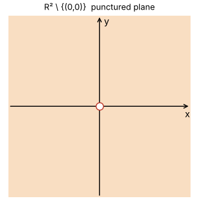
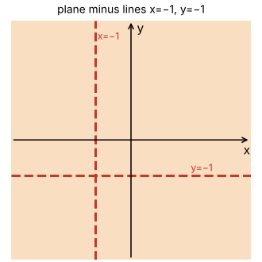
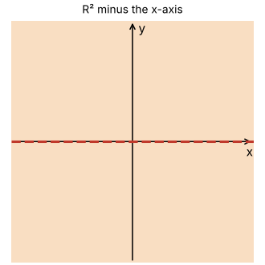
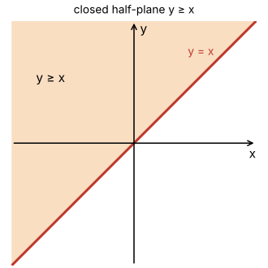
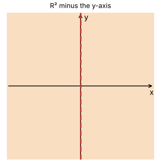
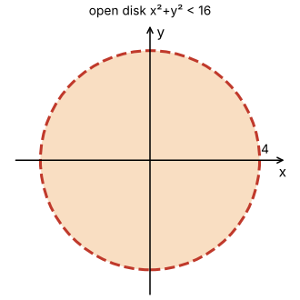
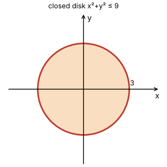
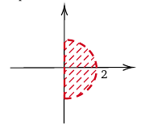

# Topic 1: End-of-topic test

Try each question first.
Then click to check.

Each answer says which notes section (§) it comes from.

---

## Part A: Tutorial questions

### Q1a (Tutorial Sheet 1 Q1 a–e)

Describe the domain in set notation, describe it in words, and sketch it if it isn't all of ℝ².

(a) $f(x,y) = \frac{1}{x^2+2y^2}$

(b) $f(x,y) = \frac{1}{(x+1)(y+1)}$

(c) $f(x,y) = \sin\frac{x}{y}$

(d) $f(x,y) = y - x$

(e) $f(x,y) = \sqrt{y-x}$

Answer

**(a)** Need x² + 2y² ≠ 0. That only fails when x = 0 and y = 0.

$$\text{dom}(f) = \mathbb{R}^2 \setminus \{(0,0)\}$$

The punctured plane.

 

**(b)** Need (x+1)(y+1) ≠ 0, so x ≠ −1 **and** y ≠ −1.

$$\text{dom}(f) = \{(x,y) \in \mathbb{R}^2 \mid x \neq -1 \text{ and } y \neq -1\}$$

The plane with the two lines x = −1 and y = −1 removed.

 

**(c)** Need y ≠ 0.

$$\text{dom}(f) = \{(x,y) \in \mathbb{R}^2 \mid y \neq 0\} = \mathbb{R}^2 \setminus \text{the } x\text{-axis}$$

 

**(d)** A polynomial. Nothing to ban. dom(f) = ℝ².

 

**(e)** Need y − x ≥ 0.

$$\text{dom}(f) = \{(x,y) \in \mathbb{R}^2 \mid y \geq x\}$$

The line y = x and the half-plane above it. Solid line.

From: §3, §4

---

### Q1f (Tutorial Sheet 1 Q1 f–i)

Same task.

(f) $f(x,y) = 4x^2+9y^2$

(g) $f(x,y) = x^2-y^2$

(h) $f(x,y) = xy$

(i) $f(x,y) = \frac{y}{x^2}$

Answer

**(f), (g), (h)** are polynomials. dom(f) = ℝ² for all three.

 

**(i)** Need x² ≠ 0, so x ≠ 0.

$$\text{dom}(f) = \{(x,y) \in \mathbb{R}^2 \mid x \neq 0\} = \mathbb{R}^2 \setminus \text{the } y\text{-axis}$$

Trap: x = 0 is the **y**-axis.

From: §3

---

### Q1j (Tutorial Sheet 1 Q1 j–m)

Same task.

(j) $f(x,y) = \frac{1}{\sqrt{16-x^2-y^2}}$

(k) $f(x,y) = \sqrt{9-x^2-y^2}$

(l) $f(x,y) = \ln(x^2+y^2)$

(m) $f(x,y) = e^{-(x^2+y^2)}$

Answer

**(j)** Root and fraction on the same thing: 16 − x² − y² > 0.

$$\text{dom}(f) = \{(x,y) \in \mathbb{R}^2 \mid x^2+y^2 < 16\}$$

Open disk, centre the origin, radius 4. Dashed circle.

 

**(k)** Root only: 9 − x² − y² ≥ 0.

$$\text{dom}(f) = \{(x,y) \in \mathbb{R}^2 \mid x^2+y^2 \leq 9\}$$

Closed disk, centre the origin, radius 3. Solid circle.

 

**(l)** ln needs x² + y² > 0, which fails only at (0,0).

$$\text{dom}(f) = \mathbb{R}^2 \setminus \{(0,0)\}$$

The punctured plane.

 

**(m)** e to any power is defined and never 0. dom(f) = ℝ².

From: §3, §4, §5

---

### E1 (Tutorial Sample exam Q1 a, b)

$$f(x,y) = \frac{\ln(x)}{\sqrt{4-x^2-y^2}}$$

(a) Determine the domain of f. Use set notation.

(b) Sketch it.

Answer

**(a)** Two things can break.

- ln(x) needs x > 0.
- The root is downstairs, so 4 − x² − y² > 0, i.e. x² + y² < 4.

$$\text{dom}(f) = \{(x,y) \in \mathbb{R}^2 \mid x > 0 \text{ and } x^2+y^2 < 4\}$$

**(b)** The open half-disk, centre (0,0), radius 2, to the right of the y-axis.

Both edges dashed.

From: §3, §4

---

## Part B: Exam-style questions

---

### M1: True or false

1. The domain of $\sqrt{x^2+y^2-1}$ is the closed unit disk.
2. $\{(x,y) \in \mathbb{R}^2 \mid x \neq 0\}$ is the plane minus the y-axis.
3. The domain of $\frac{1}{x-y}$ is $\mathbb{R}^2 \setminus \{(x,y) \mid y = x\}$.
4. $e^{x-y}$ is defined on all of ℝ².
5. "p or q" in maths means exactly one of p and q is true.

Answer

1. **False.** You need x² + y² ≥ 1: everything **outside** the open unit disk. (§3)
2. **True.** x = 0 is the y-axis. (§3)
3. **True.** The fraction needs x ≠ y, so the line y = x is removed. (§3)
4. **True.** Exponentials have no restrictions. (§3)
5. **False.** Maths "or" is inclusive: at least one, possibly both. (§1)

---

### M2: Multiple choice

What is the domain of $f(x,y) = \ln(4 - x^2 - y^2)$?

- A. $\{(x,y) \mid x^2+y^2 \leq 4\}$
- B. $\{(x,y) \mid x^2+y^2 < 4\}$
- C. $\{(x,y) \mid x^2+y^2 > 4\}$
- D. $\mathbb{R}^2 \setminus \{(0,0)\}$

Answer

**B.** ln needs its input **strictly** positive: 4 − x² − y² > 0, so x² + y² < 4.

A open disk of radius 2.

From: §3

---

### M3: Calculate

Find the domain of

$$f(x,y) = \frac{\sqrt{y}}{x^2-1}$$

Write it in set notation.

Answer

- The root needs y ≥ 0.
- The fraction needs x² − 1 ≠ 0, so x ≠ 1 and x ≠ −1.

$$\text{dom}(f) = \{(x,y) \in \mathbb{R}^2 \mid y \geq 0,\ x \neq 1 \text{ and } x \neq -1\}$$

The upper half-plane (x-axis included) with the vertical lines x = ±1 removed.

From: §3

---

### M4: Sketch

Sketch the domain of

$$f(x,y) = \frac{\ln(y)}{\sqrt{9-x^2-y^2}}$$

Answer

- ln(y) needs y > 0.
- The root is downstairs: x² + y² < 9.

$$\text{dom}(f) = \{(x,y) \in \mathbb{R}^2 \mid y > 0 \text{ and } x^2+y^2 < 9\}$$

The **upper** open half-disk of radius 3.

Shade the top half of the disk. Dashed semicircle, dashed x-axis segment from −3 to 3. Mark 3 and −3 on the x-axis.

(It's the exam sketch turned 90°.)

From: §4

---

### M5: Explain

Explain why the domain of $\frac{1}{\sqrt{A}}$ uses "A > 0" but the domain of $\sqrt{A}$ uses "A ≥ 0".

Answer

√A only needs A ≥ 0, because √0 = 0 is fine.

But in 1/√A the root is downstairs. If A = 0 you divide by 0.

So you need A ≥ 0 **and** A ≠ 0, which is A > 0.

From: §3

