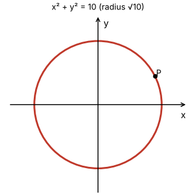
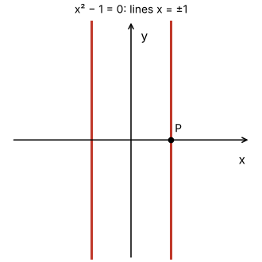
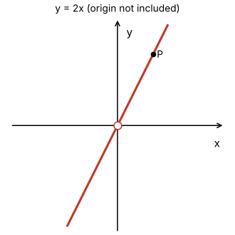

# Topic 2: End-of-topic test

Try each question first.
Then click to check.

Each answer says which notes section (§) it comes from.

---

## Part A: Tutorial questions

### Q2a (Tutorial Sheet 1 Q2 a)

Find an equation for the level curve of $f(x,y) = 16 - x^2 - y^2$ through $P = (2\sqrt{2}, \sqrt{2})$.

Answer

z₀ = f(P) = 16 − 8 − 2 = 6.

16 − x² − y² = 6, so

$$x^2+y^2 = 10$$

A circle, centre the origin, radius √10.

From: §3, §6

---

### Q2b (Tutorial Sheet 1 Q2 b)

Find the level curve of $f(x,y) = \sqrt{x^2-1}$ through $P = (1, 0)$.

Answer

z₀ = f(1, 0) = √(1 − 1) = 0.

√(x² − 1) = 0, so x² − 1 = 0, so x = 1 or x = −1.

The level curve is **two** vertical lines, x = 1 and x = −1.

From: §3

---

### Q2c (Tutorial Sheet 1 Q2 c)

Find the level curve of

$$f(x,y) = \int_x^y \frac{dt}{1+t^2}$$

through $P = (-\sqrt{2}, \sqrt{2})$.

Answer

First simplify: f(x, y) = tan⁻¹(y) − tan⁻¹(x).

z₀ = tan⁻¹(√2) − tan⁻¹(−√2) = 2 tan⁻¹(√2), because tan⁻¹ is odd.

Level curve (implicit):

$$\tan^{-1}(y) - \tan^{-1}(x) = 2\tan^{-1}(\sqrt{2})$$

From: §4

---

### Q2d (Tutorial Sheet 1 Q2 d)

Find the level curve of

$$f(x,y) = \sum_{n=0}^{\infty}\left(\frac{x}{y}\right)^n$$

through $P = (1, 2)$.

Answer

Geometric series with r = x/y. When |x/y| < 1:

$$f(x,y) = \frac{1}{1-\frac{x}{y}} = \frac{y}{y-x}$$

At P: |1/2| < 1, so f(1, 2) = 2/(2 − 1) = 2.

$$\frac{y}{y-x} = 2 \iff y = 2y - 2x \iff y = 2x$$

The line y = 2x. (Strictly, the origin is left out, since f needs y ≠ 0.)

From: §4

---

## Part B: Exam-style questions

---

### M1: True or false

1. A level curve f(x, y) = z₀ is a curve in the xy-plane.
2. Every point on a level curve has the same value of f.
3. A level curve is always one connected piece.
4. Level curves far apart on a contour plot mean the surface is steep there.
5. The level surfaces of f(x, y, z) = x² + y² + z² are spheres centred at the origin.

Answer

1. **True.** It's the shadow of the contour curve on the floor. (§2)
2. **True.** That's the definition. (§2)
3. **False.** x² = 1 gives two separate lines. (§3)
4. **False.** Far apart = gentle. Close together = steep. (§2)
5. **True.** x² + y² + z² = w₀ is a sphere of radius √w₀ (for w₀ > 0). (§5)

---

### M2: Multiple choice

What are the level curves of f(x, y) = x − y?

- A. circles centred at the origin
- B. parallel straight lines of slope 1
- C. parallel straight lines of slope −1
- D. hyperbolas

Answer

**B.** x − y = z₀ means y = x − z₀. All lines of slope 1.

From: §3

---

### M3: Calculate

Find the level curve of $f(x,y) = x^2 + 4y^2$ through $P = (2, 1)$. What shape is it?

Answer

z₀ = 4 + 4 = 8.

$$x^2 + 4y^2 = 8 \iff \frac{x^2}{8} + \frac{y^2}{2} = 1$$

An ellipse, centre the origin, crossing the x-axis at ±2√2 and the y-axis at ±√2.

From: §3

---

### M4: Sketch

Sketch the level curves of f(x, y) = x² + y² for z₀ = 1, 4, 9. Label each with its height.

Answer

Three circles centred at the origin, radii 1, 2 and 3.

Label them 1, 4, 9 from inside to outside.

The radii 1, 2, 3 are evenly spaced, but the heights jump by 3 and then by 5. So the bowl gets steeper as you go out.

From: §3

---

### M5: Explain

Why are the level curves of $z = \sqrt{1-x^2-y^2}$ circles?

Answer

Set $\sqrt{1-x^2-y^2} = z_0$.

Square both sides: x² + y² = 1 − z₀².

That's a circle centred at the origin with radius $\sqrt{1-z_0^2}$ (for 0 ≤ z₀ ≤ 1).

From: §3

